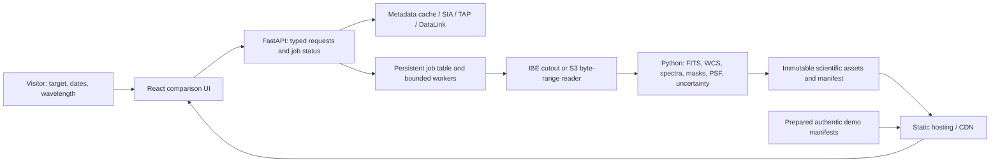

# Vantage — SPHEREx research and technical architecture dossier

**Research cutoff: 18 October 2026 America/New_York (19 October UTC).** Initial archive tests were performed on 4 October; additional file/API and software tests on 12 October; releases, schedules, selected repositories and motion fixtures were refreshed on 18 October evening / 19 October UTC. This is a research specification for a subsequent implementation run. It contains no application implementation.

**Full-challenge update: 7 November 2026.** The published objective now specifies coordinate input, playback of a fixed sky patch over time, and five named test targets. This update governs product scope and adds live archive checks; the dated October evidence remains the baseline for earlier measurements. Sections H6, J, N, T and Z specify the sequence workflow. See C for the separate November release check.

**Evidence labels:** **[V] Verified fact** means supported by an identified primary source; **[T] Tested fact** means measured against a live service or authentic file; **[I] Engineering inference** means a conclusion drawn from those facts; **[R] Recommendation** means a proposed design, policy, threshold, or budget; **[U] Unresolved** means evidence is insufficient. Recommendations are not NASA requirements. A successful metadata search proves coverage, not that a particular source is detected or that a pair is scientifically interchangeable.

Read this dossier in order for domain context; use section Z as the implementation brief. `research/evidence/` contains retained responses, schemas, headers, source text, repository checks, and timing evidence. `research/fixtures/` contains authentic files and explicitly identified research cutouts. Read `research/README.md` before rerunning probes. URLs and returned metadata, rather than filenames guessed from conventions, govern retrieval.

## A. Executive Technical Brief

**[R] Product thesis: Vantage lets anyone see what moved in the infrared sky and inspect whether the comparison is fair.** Build a public SPHEREx explorer: enter RA/Dec, play an ordered sequence of real observations of one fixed sky patch, inspect quality and provenance, and share the exact sequence. A/B blink, swipe and static comparison are secondary inspection modes. Its three differentiators are automatic spectral compatibility, understandable evidence for apparent changes, and reproducible views backed by real NASA observations.

**[V/T] Main data:** calibrated Level 2 spectral images from **QR2 and QR3**, accessed as native multi-extension FITS cutouts. Both releases exist now; their formats and calibrations differ. One Level 2 file is one detector exposure with spatially varying wavelength. It is not a 102-plane photograph. Full all-sky cubes are scheduled for November 2026 and cannot be assumed available at this cutoff. [Release overview][s02], [delivery schedule][s03], [file reference][s04].

**[R] Retrieval:** a Python service queries `https://irsa.ipac.caltech.edu/SIA` with explicit collections, follows the returned data URL, and appends the documented IBE cutout parameters. Use TAP for precise metadata joins and DataLink for calibration associations. Keep an anonymous S3 range-reading fallback and a cache of prepared demonstrations. Tested IRSA responses did not grant cross-origin browser access; tested S3 range responses did. An IRSA request can also return 503, so external availability cannot sit on the critical demo path. [SIA][s05], [cutouts][s06], [TAP][s07], [cloud][s08]; local response evidence.

**[R] Architecture:** React + TypeScript + Vite frontend; synchronized Canvas comparison surfaces and accessible HTML/SVG controls; Python FastAPI API with bounded scientific worker processes; Astropy, PyVO, NumPy, SciPy, Reproject, and Photutils; immutable derived assets in object storage/CDN; SQLite for a single-instance hackathon deployment. Prepared data and the live processing service use the same manifest and provenance contract. Python performs FITS/WCS/calibration work. The browser handles display, pan, zoom, blink, swipe, stretch, cursor readouts, and selection. Aladin Lite is an optional context atlas, not the comparison engine.

**[R] Scientific method:** retain timestamps and releases; evaluate spatial TAN-SIP WCS and detector-position wavelength; reject incompatible bands; use calibration maps for quantitative work; propagate masks, coverage, and uncertainty through registration and PSF matching; separate display stretching from scientific normalization; identify residuals as candidates, not discoveries. A per-pixel significance display is enabled only when its variance and covariance assumptions have been validated. [Intro notebook][s09], [PSF notebook][s10], [spectral calibrations][s11], [Reproject][s12].

**[T/R] Demonstration:** start by entering the challenge’s WISE 0855 coordinate and playing three real QR2 observations of that fixed field. Use the four other named fields to test coverage, coordinate propagation and quality warnings. The supplied Ceres pair provides a separate, conspicuous positional-motion example. M101 is the static spectral-compatibility control, and 3I/ATLAS illustrates source-tracked views. Section J and `demo_dataset_manifest.json` document which claims the observations support.

**[I] Largest risk:** sampling a different part of an LVF can imitate brightness change. Matching a detector number, nominal channel, or frame-wide SIA `BAND` interval does not solve that problem. A pair can match at the target and fail elsewhere in the image. Vantage must expose the compatible footprint and decline numerical comparison when it is insufficient.

## B. Challenge Interpretation

**[V] The live 2026 page identifies “Planet X and SPHEREx” as an advanced challenge.** Its full Objectives were checked in the browser on 7 November: accept RA/Dec for a patch of sky, display a temporal series of that patch, and test **Barnard’s Star, Epsilon Indi B, WISE 0855, RW Aurigae and R Draconis**. A selected pair or curated gallery alone does not meet the sequence requirement. Coadds/differences, changing the field of view, other-survey overlays, coordinate URLs, quality metadata and live spectra are optional considerations in the brief; this dossier recommends a subset in V. The FAQ lists **14–15 November 2026** for the event and **13 November** for the guides and additional challenge resources. [Challenge][s13], [current FAQ][s14].

| Phrase in the supplied summary | Implementation meaning | Scientific boundary |
|---|---|---|
| Mapping the sky every six months | Show actual acquisition times and coverage; support separated observing periods | A survey cadence is not a guarantee of two suitable exposures at every location |
| 102 bands | Let users select available wavelength samples and explain LVF sampling | Do not invent 102 simultaneously acquired images for each exposure |
| More than a billion objects | Provide spatial discovery and curated starting points | This is mission-scale context, not a currently downloadable billion-row public catalog |
| Shifting position | Align the sky before assessing movement | Detector coordinates and pointing changes are not source motion |
| No one person can sift through it | Reduce data-access friction and guide attention | A candidate queue requires controlled false positives and traceable inputs |
| Public-facing web tool | Usable controls, explanations, accessibility, shareable states | Do not expose a notebook or a FITS upload form as the entire product |
| Quickly see change over time | Cached comparisons, immediate switching, honest loading stages | Speed must not bypass wavelength, quality, or coverage checks |

**[R] Combine temporal visualization, data accessibility, known-object exploration, and cautious change-detection support.** Citizen science is a later extension, with classifications preserving exactly which data were examined. Spectral exploration is a complementary mode and a guard against false temporal interpretations.

| Apparent change | What is happening | What Vantage can responsibly show |
|---|---|---|
| Solar System motion | Observer-relative motion, changing geometry, possible intra-exposure trailing | Astrometric displacement and a dated known-object ephemeris; no orbit claim from two images |
| Stellar proper motion | Long-term transverse motion | Measured displacement; a catalog prediction with coordinate epoch, proper motion, and uncertainty |
| Parallax | Observer movement changes apparent position | Explain that two positions combine parallax and proper motion; fit them separately only with adequate epochs and observer geometry |
| Brightness variability | Source emission changes | Matched-band measurements with PSF, background, calibration, and uncertainty controls |
| Transient | Source appears/disappears | An unmatched residual requiring independent exposures and quality review |
| Spectral change | Different wavelength or different spectral shape | A spectral comparison explicitly labeled as such |
| Cosmic ray / persistence / ghost / halo | Instrumental effect | Quality warning or rejected candidate; unflagged pixels are not proof of cleanliness |
| Different viewing geometry | Roll, PSF, foreground, source blend, or moving-object phase changes | Context and limitations, not automatic physical classification |

**[I] Planet X is a motivating discovery context, not an attainable validation claim for this prototype.** A distant moving-source search needs multi-epoch astrometry, spectral consistency, artifact rejection, completeness/selection analysis, known-object exclusion, and independent follow-up. A pair of residuals cannot identify a planet, determine distance, or establish an orbit. [Mission science][s15], [Planet Nine orbital-search literature][s16].

## C. Current SPHEREx Data Availability

**[V/T] November checkpoint (7 November 2026).** IPAC DOI records describe November DR1 spectral images and the all-sky cube, and updated Explorer help refers to DR1. The linked IRSA landing page returned HTTP 404, the anonymous SPHEREx bucket root listed only `qr2/` and `qr3/`, and the tested `COLLECTION=spherex_dr1` SIA cone returned an empty `QUERY_STATUS=OK` table. That cone does not establish the status of the whole collection. Successful QR2 and QR3 queries and direct QR2 FITS retrieval establish the core path. Gate each DR1 product on documented access and a successful sample with expected HDUs/metadata. Treat the combined cube as spectral context unless its metadata supports independent epochs. The DR1 Level 2 DOI identifies DR1 as a reprocessing of QR2 for use alongside QR3. Deduplicate by physical exposure and detector when choosing between versions, retaining release and artifact identity in each immutable result. [DR1 image DOI][s76], [DR1 cube DOI][s77], [updated Explorer help][s78], [current archive access guide][s72].

**[T] Collection-only follow-up.** With `MAXREC=1` and no spatial constraint, `COLLECTION=spherex_dr1` returned HTTP 200 and zero rows with `QUERY_STATUS=OK`. The same query for `spherex_qr2` returned one row and `QUERY_STATUS=OVERFLOW`, the expected positive control for the row cap. This verifies behavior for the tested collection name. The two responses do not establish whether DR1 is accessible through another product-specific path. See `research/evidence/full_sia_collection_*.json` and the raw VOTables. [IRSA SIA][s05].

| Product/release | Status at cutoff | Governing implementation decision | Evidence |
|---|---|---|---|
| QR1 | **Retired February 2026**; no longer available from IRSA | Do not use old QR1 tutorial URLs or DOI as the default | [Current overview][s02] |
| QR2 | Public; reprocessed first quick-release images; weekly archive ingestion | Main historical baseline; retain exact processing version | [Overview][s02], tested SIA/IBE/S3 |
| QR3 | Public since September 2026 | Support separately; inspect `EPSF` and current calibrations | [IRSA mission page][s01], actual QR3 fixture |
| QR2/QR3 Level 2 spectral images | Available, detector exposure MEFs | Main temporal viewer inputs | [Product guide][s04] |
| Year-one reprocessed calibrated images / DR1 | November DOI and help published; sample access not established on 7 November | Probe exact data/calibrations, then deduplicate replacements against QR2 | [Schedule][s03], [DR1 images DOI][s76] |
| All-sky 102-channel data cube | November DOI published; usable cube endpoint not verified | Optional spectral context; verify actual epoch metadata before using for time comparisons | [Schedule][s03], [DR1 cube DOI][s77] |
| Second annual reprocessing/cubes | Planned December 2027 | Future migration only | [Schedule][s03] |
| High Reliability Source Catalog | Planned August 2027 and January 2028 | Not a current source-discovery backend | [Schedule][s03] |
| Spectral WCS/channel maps, ePSFs, calibration associations | Public | Download/cache versioned detector calibrations | [Guide][s04], [calibration package][s11], DataLink tests |
| SPLICES target list | Public ancillary catalog | Optional ice-source target enrichment, not SPHEREx detection catalog | [Mission links][s01] |
| Dedicated 3I/ATLAS image list | Public; tested manifest contains 259 entries | Strong curated source of real comet observations | [Dedicated dataset][s17] |
| Data Explorer, cutouts, mosaic, spectrophotometry, MOST | Public tools | Use the documented APIs where available; link to interactive tools otherwise | [IRSA mission page][s01] |
| Source Discovery Tool | Public notebook/package workflow | Algorithm/reference material, not a verified hosted detection API | [Official demo][s18] |
| Public all-sky publicity images/videos | Available | Context only; not a substitute for calibrated time-resolved cubes | [Mission gallery and science products][s15] |

**[V] QR2 corresponds to processing versions 6.4–6.5.6. R7 and later underlie QR3/DR1, with changes to calibration, astrometry, flags, zodiacal prediction, and photometry.** Early survey-3/4 data from 16 May–19 July 2026 were initially processed with 6.5.6; their R7 replacements are scheduled with the later reprocessing. A release label is not a clean acquisition-date boundary. [Explanatory Supplement, section 2.1][s19].

**Source conflicts to handle explicitly:**

| Conflict | Decision |
|---|---|
| Supplement says QR1 remains downloadable; current overview says retired | Current release-overview page governs availability |
| Cloud overview emphasizes QR2; current bucket contains `qr2/` and `qr3/` | Actual bucket listing and QR3 file are stronger evidence for current content |
| General MEF prose says image-cube PSF; QR3 contains a binary `EPSF` table | Inspect HDU names/types and use release-aware parser branches |
| Mosaic help describes three data HDUs; actual sample has six total HDUs | Parse actual named extensions, including primary and tables |
| Mosaic pixel-size limits differ between older supplement and inspected UI | The live UI currently accepts a minimum 6.15 arcsec; do not hardcode the old 9 arcsec minimum |
| PSF fix date appears as 31 March in an erratum and 10 April on the mission timeline | Treat these as correction/publication timing differences; detect corrected file/version content |
| Spectrophotometry prose assigns `4294967296` an incorrect bit number | Use the table's bit 32 and exact integer value; never shift by the inconsistent prose number |
| SDT notebook acknowledgment still gives QR1 DOI while describing QR2 | Use current overview's release-specific DOI |

These conflicts are documented in the retained source text and actual-file tests. No unresolved conflict should be resolved by assuming that an old worked example is current.

## D. SPHEREx Technical Primer

**[V] SPHEREx observes near-infrared light from roughly 0.75–5 µm using six detector/filter bands.** Its mission science addresses cosmological structure, integrated cosmic light, and interstellar/planet-forming ices. The useful developer consequence is that sky position, wavelength, time, and calibration must travel together. [NASA mission][s15], [instrument/mission paper][s20].

| Detector | Approximate wavelength interval, µm | Nominal resolving power λ/Δλ | Paired simultaneous field |
|---|---:|---:|---|
| D1 | 0.75–1.09 | 39 | D4 |
| D2 | 1.10–1.62 | 41 | D5 |
| D3 | 1.63–2.41 | 41 | D6 |
| D4 | 2.42–3.82 | 35 | D1 |
| D5 | 3.83–4.41 | 112 | D2 |
| D6 | 4.42–5.00 | 128 | D3 |

Boundaries/resolution in this table are descriptive; measured calibration values govern individual pixels. The IRSA mission page uses rounded band boundaries. [Mission characteristics][s01], [spectral fiducial document][s21].

**[V] A linear variable filter changes wavelength with detector location.** Each detector has 17 nominal spectral-channel regions; six times 17 gives 102. Repeated pointings move a sky source across the filter and build its spectral samples. The actual two-dimensional calibration has curvature (“smile”), and within one nominal channel different pixels still have different central wavelengths. A Level 2 image is a two-dimensional exposure of approximately **2040×2040 pixels**, each sampling a local response function. It has a wavelength lookup extension, not 102 separate image planes. [Image intro][s09], [calibration definition][s11], authentic QR2/QR3 HDUs.

**[V/T] Native pixel spacing is about 6.15 arcsec.** Sampling and PSF are different quantities; the fixture headers report PSF FWHMs near 5.15 arcsec for one QR2 D2 frame and 7.53 arcsec for one QR3 D1 frame. Neither is a universal mission PSF. Spatial WCS uses equatorial sky coordinates with distortion; query coordinates are ICRS degrees. The spectral WCS is a separate alternate WCS (`W`) with tabular wavelengths/bandwidths. [PSF notebook][s10], [intro][s09], fixture headers.

**[R] Coordinate conventions:** arrays are indexed `[y,x]`; high-level Astropy pixel coordinates are zero-based `[x,y]`; FITS header reference pixels use FITS convention. Avoid ad hoc origin changes. Transform RA/Dec through the spatial WCS, then evaluate spectral calibration at the corresponding **parent detector** pixel. Screen images usually place row zero at the top; astronomical arrays conventionally plot row zero at the bottom. Record the exact browser-to-array mapping and test it.

**[V] Survey/deep-field coverage is irregular in time and denser near survey poles.** An “epoch” should be an actual exposure, or an explicitly defined collection of exposures with start/end/weighted time—not simply “spring” or “survey 1.” Data collection, planning-period identifier, processing date, and observation date are separate. [Mission paper][s20], [header/product definitions][s04].

**[V] IMAGE is calibrated surface brightness in MJy/sr; VARIANCE is its squared unit; ZODI is a modeled foreground that has not already been subtracted from IMAGE.** Point-source flux requires solid-angle conversion and a source/background/PSF measurement. Do not display an image pixel as a µJy source flux. A basic conversion is `Fν[Jy] = Iν[MJy/sr] × 10^6 × Ω[sr]`; integrating a source additionally requires background subtraction and appropriate aperture/PSF treatment. [Image products][s04], [photometry pipeline][s22].

## E. Data Product Matrix

The following rows cover public products relevant to this application. “Available” means documentation plus archive paths/associations exist; individual calibration families were not all downloaded. Sizes marked **T** are measured bytes; other sizes are guide estimates or arithmetic estimates, not download guarantees.

| Product/service | Level; format; approximate size | Spatial/spectral/time structure and cadence | Calibration/quality | Browser / temporal / automated suitability | Access; benefits; costs; Vantage choice |
|---|---|---|---|---|---|
| QR2 spectral image | L2; MEF FITS; about 70 MB, one D3 example **71,634,240 B T** | 2040² detector pixels; spatially varying λ; one exposure; UTC/MJD headers; weekly ingestion | Calibrated, legacy PSF and earlier flags; zodiacal foreground retained | Derived display yes; matched temporal yes; detection conditional | SIA/TAP → IBE or S3; historical coverage; core |
| QR3 spectral image | L2; MEF FITS; example **65,851,200 B T** | Same native spatial concept; `EPSF` table; one exposure | R7 calibration/flags; do not silently mix with QR2 | Same conditional suitability | Same interfaces; current data; core parser support |
| Native L2 cutout | Spatial subset MEF; tested QR2 **5,106,240 B**, QR3 **4,000,320 B** | Native pixels; all science layers; full PSF/ePSF and wavelength table retained | No reprojection or new calibration | Best processing input; backend conversion needed | IBE parameters on returned parent URL; core; PSF overhead prevents tiny KB downloads |
| Custom mosaic | Derived channel cube MEF; sample **87,295,680 B T** | Tested `(102,267,267)` image/count/flags; TAN grid; channel wavelength table; aggregates available observations | Selected flags and ZODI treatment; no VARIANCE in tested output | Excellent spectral/context display; **not** an epoch comparison by default | Interactive tool; no documented API; optional reference/context |
| All-sky science cubes | Planned higher-level FITS/maps | 102 channels; annual products | Future release defines exact schema | Future context; epoch suitability must be checked then | No current endpoint verified; excluded from core dependency |
| High Reliability Source Catalog | Future higher-level catalog | Time-resolved spectra for high-SNR sources | Future selection/calibration | Future enrichment; not current | Planned schedule only |
| Spectral WCS | Calibration MEF; **33,312,960 B T** for D2/D3 | CWAVE, CBAND maps 2040²; WCS-WAVE approximation | Version/detector dependent; QR2 v4 map association tested | Required for quantitative λ gate; cache server-side | DataLink/TAP calibration associations / S3 |
| Spectral-channel map | Calibration FITS; roughly 16 MB plus table | Pixel channel indices 0–18; 17 nominal channels; per-detector summary | Geometric channel assignment, not exact wavelength | Useful wavelength UI/mosaics; insufficient temporal gate alone | Product guide / calibration directory; optional cached map |
| Lab spectral-response package | Tar; CSV response curves, FITS parameter maps | 17/34/51/68 subchannels per detector; middle/all-pixel curves | Documented orientation and channel-numbering rules | Advanced bandpass-overlap analysis | Public calibration page; do not fetch entire tar per request |
| Average PSF (legacy) | Calibration MEF; about 5 MB | 121 oversampled 101² images, local detector zones | Header erratum; superseded modeling available | Inspect/reproduce older files; prefer new ePSF | QR2 associations; core must recognize, advanced fitting uses ePSF |
| Effective PSF | Calibration FITS table + preview; embedded table in QR3 | 441 zones, D3 451; 33² samples, oversampling 5 | Current official notebook recommends for older frames too | PSF assessment/matching/photometry | QR3 `epsf/`; cached per detector |
| Absolute gain matrix | Calibration FITS; about 16 MB | 2040² per detector | Already applied by L2 pipeline | Do not recalibrate IMAGE a second time | Provenance/reference only |
| L3 flux correction | Calibration FITS; about 16 MB per detector | Per-pixel QR2→new-gain scaling | Needed for approved cross-release quantitative comparison | Advanced; requires exact application direction and uncertainty policy | QR3 `l3_flux_corrections/`; core remains within release |
| Solid-angle pixel map | Calibration FITS; about 16 MB | 2040², arcsec² per native pixel | For surface-brightness→flux measurements | Advanced source photometry | Versioned calibration; cache |
| Dark, nonfunctional and dichroic maps | Calibration FITS; roughly 16–32 MB each; tested dichroic association 16,652,160 B | Detector calibration/quality maps | Already used in L2 generation/flags | Diagnostics, not a second full reduction | DataLink exposes the dichroic file as well as dark/nonfunctional products; provenance only |
| Nonlinearity / read-noise parameters | MEF; roughly 79/48 MB | Nonlinearity coefficient maps; read noise/ramp parameters | Applied upstream | Not required to regenerate L2 or its VARIANCE | Exclude runtime downloads |
| SIP calibration | FITS header coefficients | Detector prior distortion | Final frame WCS may include fitted corrections | Use delivered frame WCS; calibration for audit | Provenance/advanced validation |
| Aurora / He / shuttle-glow templates | QR3 calibration FITS; 2040² | D1 aurora; D1/D2 He; D5 glow | Background/diagnostic templates | Warn about structured residuals; no automatic source classification | Optional diagnostics |
| Crosstalk parameters / Zodi scaling | QR3 ECSV | Mask rules; per-band model scaling | Upstream processing inputs | Do not invent substitute correction models | Provenance/advanced investigation |
| Gain-factors YAML | Calibration configuration; tested association **5412 B** | Pipeline conversion parameters | Upstream configuration | Reference only | DataLink; never execute YAML tags |
| Spectrophotometry Tool | Forced measurements, downloadable tables | λ, flux, error, MJD, detector, collection, image coordinates, flags | New gain handling; forced positions and shapes | Useful advanced spectrum; not a moving-comet default | Interactive tool; stable public REST API not verified |
| Source Discovery Tool | Python notebooks/package; local workflow | SExtractor/source extraction, aperture photometry, wavelength samples | Example code requires audit/version fixes | Algorithm reference; not temporal detection out of box | Official BSD-3-Clause repository; advanced concepts |
| MOST | Metadata search; HTML/IPAC/VOTable | Orbit/ephemeris → image footprints at observation times | Prediction is not detection | Known-object discovery; core curated, advanced live route | Documented CGI API; distinguish two returned tables |
| SPLICES | Ancillary source catalog | Target positions and source selection | Prior target catalog | Optional ice-region exploration | IRSA catalog services; not current SPHEREx measured spectra |
| Data Explorer / Firefly | Interactive archive interface | Search, tables, footprints, images, tools | Exposes data and metadata | Strong reference/link-out; avoid cloning full interface | Public browser tool; documented embedding/search options |
| AWS / Fornax | Hosting/compute, not new scientific products | Public bucket; cloud analysis platform | Same source data, separate access concerns | S3 range fallback/batch; Fornax optional preprocessing | No cloud account required for public S3; Fornax account is separate |

Product family definitions are grounded in the [archive guide][s04], [supplement][s19], [PSF tutorial][s10], [mosaic tutorial][s23], and [photometry help][s24]. Detailed access and measured fixtures follow.

### Mosaic decision

**[V/T] The Custom Mosaic Tool can make spatial mosaics on a consistent TAN projection and return a multiwavelength cube across selected nominal channels.** Its live form permits field sizes up to 300 arcmin, rotation, output pixel size, and wavelength limits. It has no epoch/time selector in the inspected form. The official notebook explicitly says there is no API. The public M101 sample contains PRIMARY, IMAGE, NHITS, FLAGS, SPECTRAL_CHANNELS, and WCS-WAVE. There is no uncertainty image in that sample. [Mosaic tutorial][s23], [mosaic help][s25], `m101_mosaic_hdus.json`.

**[I/R] Therefore mosaics do not simplify the core temporal architecture.** They standardize a spatial grid and nominal channels, but aggregate exposures across time and leave within-channel response variations. Use them for context, spectral browsing, and an official-output sanity check. Constructing two time-filtered mosaics oneself would require a separate validated mapmaking pipeline, correct temporal manifests, variance/coverage propagation, and effective-bandpass accounting. That is an exceptional feature, not a hidden shortcut. [SPHEREx mapmaking paper][s26]. `NHITS` must not be presented as “number of independent observations” without inspecting the generator's input-pixel counting semantics.

## F. Data Access/API Reference

### F1. SIA v2 — main footprint discovery

**Endpoint:** `GET https://irsa.ipac.caltech.edu/SIA`. Public SPHEREx data require no API key. Exact collection strings: `spherex_qr2`, `spherex_qr2_deep`, `spherex_qr3`, `spherex_qr3_deep`. Use uppercase documented query parameter names. [IRSA SIA documentation][s05], [IVOA SIA standard][s27].

| Parameter | Type / units | Use and trap |
|---|---|---|
| `COLLECTION` | Exact collection name | Always explicit; query releases separately |
| `POS` | `CIRCLE ra dec radius`, `RANGE`, or `POLYGON`; degrees, ICRS | Footprint intersection; radius is not cutout full width |
| `TIME` | MJD day interval | Exposure-time overlap; translate requested UTC dates with Astropy Time |
| `BAND` | Wavelength interval **in meters** | Whole-frame spectral bounds; does not establish the target pixel's λ |
| `CALIB` | Calibration level; use 2 for L2 if filtering | Keep actual returned level |
| `MAXREC` | Maximum result rows | Bound requests; inspect VOTable `QUERY_STATUS`, including `OVERFLOW` |
| `FORMAT` | Service-supported output selection | VOTable safest for units/schema; documented CSV/JSON alternatives exist |

Tested query:

```text
https://irsa.ipac.caltech.edu/SIA?COLLECTION=spherex_qr2&POS=CIRCLE%20210.80227%2054.34895%200.001&MAXREC=2000
```

**[T] Result:** HTTP 200, `QUERY_STATUS=OK`, **368 rows**, 781,705 bytes, 24.346 seconds in the initial run. The identical position against `spherex_qr3` returned **zero rows**, also OK. These are snapshot counts, not permanent expectations. Eight additional QR2 target queries returned 241–598 rows each in approximately 21–29 seconds. See `sia_*_probe.json` and raw VOTables.

Returned fields required by Vantage:

```text
obs_collection, obs_id, obs_publisher_did, energy_bandpassname,
dataproduct_type, calib_level, s_ra, s_dec, s_region,
s_xel1, s_xel2, s_pixel_scale, t_min, t_max, t_exptime,
em_min, em_max, em_res_power, access_url, access_format,
access_estsize, cloud_access
```

`em_min/max` are meters; `t_min/max` are MJD days; `t_exptime` is seconds. `s_ra/s_dec` are frame center, not source location. ObsCore `access_estsize` is kilobytes; use artifact `contentlength`, DataLink `content_length`, or HTTP headers for byte limits. `cloud_access` is JSON embedded in a table cell, with an `aws` object containing bucket, key, and region. Parse it defensively. The retained field metadata is the authoritative schema for the tested response. [ObsCore][s28].

**Failure/limits:** no rows is a valid result; HTTP success can contain a VO error; truncation must not silently become completeness. SIA has a documented five-minute query timeout and approximately one-day indexing lag relative to newly ingested archive data. No reliable public requests-per-second limit was found. **[R]** two upstream requests concurrently per service, explicit timeouts, deduplication, bounded retry on transient responses, and a metadata cache are application policy. Do not retry invalid queries.

**[T/I] Browser access:** a GET with `Origin: https://vantage.example` returned no `Access-Control-Allow-Origin` header in the tested SIA response. A server-side successful request is not proof of browser-readable CORS. Use the Python service. Avoid an undocumented external CORS proxy. [CORS behavior][s29].

### F2. TAP — precise joins, sorting, calibration provenance

**Endpoints:** service base `https://irsa.ipac.caltech.edu/TAP`; synchronous `/sync`; asynchronous `/async`. Use `REQUEST=doQuery`, `LANG=ADQL`, `QUERY`, `FORMAT`, and `MAXREC`. Public queries do not require credentials. Synchronous timeout is five minutes; asynchronous jobs permit much longer processing, documented up to three days. Do not use a long synchronous job for browser interaction. [IRSA TAP][s07], [IVOA TAP][s30].

Verified schema tables:

| Table | Useful fields | Purpose |
|---|---|---|
| `spherex.observation` | `obsid`, `collection`, `observationid`, `target_name`, `target_moving`, instrument/telescope fields | Release and observation identity |
| `spherex.plane` | `planeid`, `obsid`, `productid`, `energy_bandpassname`, energy/time bounds, `time_exposure`, `poly`, `provenance_version`, `obs_publisher_did`, quality/provenance metadata | Detector plane and footprint |
| `spherex.artifact` | `planeid`, `uri`, `contenttype`, `contentlength`, `contentchecksum` | Exact file path and bytes |
| `spherex.obscore` | Standard ObsCore columns | Standards-based discovery |
| `spherex.provenance_input` | Provenance association fields | Lower-level calibration linkage; inspect TAP_SCHEMA before relying on field names |

**[T] The following complete join query returned five D2 QR2 M101 rows on 12 October:**

```sql
SELECT TOP 5
  o.collection, o.observationid, p.energy_bandpassname,
  p.time_bounds_lower, p.time_bounds_upper,
  p.provenance_version, p.obs_publisher_did,
  'https://irsa.ipac.caltech.edu/' || a.uri AS access_url
FROM spherex.observation o
JOIN spherex.plane p ON o.obsid=p.obsid
JOIN spherex.artifact a ON a.planeid=p.planeid
WHERE 1=CONTAINS(POINT('ICRS',210.80227,54.34895),p.poly)
  AND p.energy_bandpassname='SPHEREx-D2'
  AND o.collection='spherex_qr2'
ORDER BY p.time_bounds_lower
```

First returned observation: `2025W19_2B_0346_1`, time bounds `60805.711548` to `60805.712880`, provenance version `6.4`. The first five include the four small slews of `0346` and `0377_1`. Raw query URL and CSV are retained in `tap_m101_join_probe.json` / `.txt`.

Schema discovery query:

```sql
SELECT column_name, datatype, unit, description
FROM TAP_SCHEMA.columns
WHERE table_name='spherex.plane'
```

**[R]** Build ADQL from typed coordinates, fixed table/column names, and allowlisted collections. Escape literals using ADQL rules; an apostrophe is doubled, not backslash escaped. Paginate explicitly with stable identity/time ordering; a `TOP` query alone does not prove completeness. Use PyVO TAP for asynchronous UWS lifecycle handling rather than inventing job polling. [PyVO][s31].

### F3. DataLink — distinguish a manifest link from an image

**[T] Some SPHEREx `access_url` values, notably the dedicated comet list, point to a DataLink document.** The tested request is:

```text
https://irsa.ipac.caltech.edu/datalink/links/spherex?ID=ivo%3A%2F%2Firsa.ipac%2Fspherex_qr2%3F2025W31_2A_0156_1%2FD3
```

It returns a VOTable containing `id`, `access_url`, `service_def`, `error_message`, `semantics`, `description`, `content_type`, `content_length`, authorization indicators, path/center fields, and `cloud_access`. The tested table has **11 rows**: one `#this` science FITS, a `#cutout` service descriptor, and associated calibration files. Select `#this` with no `error_message` and appropriate FITS content type for the parent image. Select named `#calibration` products separately. A blank URL with `service_def` is not a downloadable file. Preserve the publisher identifier. [IVOA DataLink][s32], retained `comet_datalink.vot`.

This is a currently tested mission-specific interface, but its returned associations still need version checks. Do not replace a QR2 calibration with a similarly named QR3 file without an explicit documented mapping.

### F4. IBE native cutouts — small science inputs

**[V/T] Append cutout parameters to a returned on-premises FITS URL.** Example verified with real bytes:

```text
https://irsa.ipac.caltech.edu/ibe/data/spherex/qr2/level2/2025W19_2B/l2b-v20-2025-247/2/level2_2025W19_2B_0346_4D2_spx_l2b-v20-2025-247.fits?center=210.80227%2C54.34895deg&size=0.1deg
```

`center` is an RA,Dec pair in J2000/equatorial coordinates, with documented angular units; examples also use the shorthand `d`. `size` is **full width**, with one value for a square or two for width,height; degrees by default, explicit `deg`, `arcsec`, and pixel-unit forms are supported. Examples: `size=30,45arcsec` and `size=100,200pix`. A circle-search radius of 0.1 degree is not the same size request. [IBE cutout API][s06], [official SPHEREx cutout tutorial][s33].

The cutout is uncompressed multi-extension FITS, uses native detector axes, and does not resample north-up. Preserve science layers and WCS. The tested six-arcminute QR2 result is 59×59 pixels, not exactly a fixed 60×60 output; the QR3 result is 59×58. Edge clipping and native-pixel rounding change dimensions. A rectangular cutout on a rotated detector is not exactly a north-up celestial rectangle.

**Limits/failures:** no explicit SPHEREx-specific maximum dimension/rate limit was verified beyond the parent image and overlap behavior. Malformed requests are documented as errors; no overlap can yield a server error rather than a conventional empty image. Tests also encountered persistent **503** for selected valid M101 cutout URLs. Treat this as an upstream failure and use bounded retry/cache/S3 fallback, not fabricated pixels. Successful initial cutouts took about 3.4–3.6 seconds; this is a single-client observation, not an SLA. No ACAO appeared in tested IBE cutout responses.

**[R] Request a padded input:** desired common sky box → project all four corners into each parent detector → expand for PSF kernel/interpolation margins → request the enclosing detector box. Retrieve more than the final output when needed, then apply the common output footprint. Merely requesting equal angular `size` on two differently rotated detectors can clip corners. Return `partial_coverage` explicitly.

### F5. AWS anonymous object access and range fallback

Bucket **`nasa-irsa-spherex`**, region **`us-east-1`**, with tested top-level `qr2/` and `qr3/`. Use the `cloud_access` cell or DataLink metadata rather than constructing a version/date. The public AWS registry and IRSA cloud documentation describe anonymous access. [AWS registry][s34], [IRSA cloud][s08].

Verified object:

```text
https://nasa-irsa-spherex.s3.us-east-1.amazonaws.com/qr3/level2/2026W30_1B/l2b-v27-2026-222/1/level2_2026W30_1B_0001_1D1_spx_l2b-v27-2026-222.fits
```

**[T]** Full object size **65,851,200 bytes**, modification time 17 September 2026 in the tested metadata. `Range: bytes=0-65535` returned HTTP **206**, exactly 65,536 bytes, `Accept-Ranges: bytes`, the correct total in `Content-Range`, and `Access-Control-Allow-Origin: *`. The tested allowed methods were HEAD/GET. `ETag` was exposed; `Content-Range` was not listed in exposed headers. Do not assume a browser can read every response header merely because the body is accessible. ETag is not universally an MD5 checksum.

Verified layout:

```text
qrN/level2/<planning-period>/<l2b-version-processing-date>/<detector>/level2_<observation-id>D<detector>_spx_<l2b-version-processing-date>.fits
qrN/<calibration-type>/<calibration-version-date>/[<detector>/]<calibration-file>
```

**[R] Selection by workload:** IBE is the simplest interactive native-MEF cutout route; use S3 range reads for cached preprocessing, IBE outages, or cloud-adjacent batch jobs. Astropy `fits.open(url, use_fsspec=True, fsspec_kwargs=...)` plus HDU `.section[y0:y1,x0:x1]` avoids loading the full image. `.data` can trigger a full remote-array read. `fsspec` HTTP access also requires its HTTP dependency, `aiohttp`, which was necessary in the tested environment. Cache headers/calibration tables and tune block size; a tiny block with many requests can be slower than a larger transfer. [Astropy remote FITS][s35].

**[T] The S3 native-section fallback was cross-checked against the authentic IBE fixture: IMAGE, FLAGS, VARIANCE, ZODI, PSF and wavelength-table values were exactly equal, the HDU names matched, and the tested sky/pixel/wavelength results were identical. `native_crop_equivalence.json` records the result. This proves the tested crop case, not every possible projection/edge/MEF. Native cropping must update every affected spatial/alternate reference-pixel mapping, retain wavelength lookup tables and PSF information, and preserve parent-pixel offsets. Astropy `Cutout2D` on IMAGE alone is not a complete replacement for the mission cutout MEF. Section T specifies a cross-check against an IBE fixture. S3 does not implement the IBE `center/size` query semantics.

### F6. MOST — known Solar System objects

**Endpoint:** `GET https://irsa.ipac.caltech.edu/cgi-bin/MOST/nph-most`. Documented inputs include `catalog=spherex`; `input_type=name_input`, `naifid_input`, `mpc_input`, or `manual_input`; `obj_name` or `obj_naifid`; optional `obs_begin`, `obs_end` formatted as UTC `yyyy mm dd hh:mm:ss`; `ephem_step` in days (default 0.25). Orbital-element inputs have separate asteroid/comet fields; use them only when supplied by a trustworthy orbit source. [MOST API][s36].

Verified query:

```text
https://irsa.ipac.caltech.edu/cgi-bin/MOST/nph-most?catalog=spherex&input_type=naifid_input&obj_naifid=20000001&obs_begin=2025%2004%2001&obs_end=2026%2008%2001&output_mode=VOTable
```

**[T]** `Ceres` by name returned an ambiguity error, with multiple possible objects/identifiers. Choosing the returned asteroid NAIF identifier `20000001` resolved it. The broad query returned **287 matched-image rows** and **1907 orbital-path rows**, in two separate VOTable tables. The August-only test had **zero image matches** and **37 ephemeris rows**. Parse the table ID `imgframes_matched_final_table.tbl`, not a total count across both tables. Astropy requires `table_id=0` or the matching ID when multiple tables exist.

The actual SPHEREx match columns include `ra_obj`, `dec_obj`, `sun_dist`, `geo_dist`, `dist_ctr`, `phase`, `vmag`, `observationid`, `planeid`, `productid`, `start_date`, `end_date`, `mjd_start`, `mjd_end`, `exposure_time`, frame/corner coordinates, `uri`, and `id`. Here `uri` is a relative science-file path; prefix the documented IRSA host once. `ra_obj/dec_obj` are predictions; frame `ra/dec` are not object coordinates. `vmag` is not a near-infrared measured flux.

Documentation conflicts between `outfmt` in the parameter table and `output_mode` in examples; **`output_mode=VOTable` worked in these tests**. Store this tested request, detect malformed/ambiguous/no-match responses, and avoid asserting unsupported service guarantees. No numerical rate limit/CORS grant was verified. Cache orbit-search results; repeat at build time because orbit solutions and archive contents change.

### F7. Existing tools that save work

| Tool | Public interface actually established | Vantage use |
|---|---|---|
| Data Explorer | Browser archive search, image/table inspection, tool launch; documented application interfaces | Source-of-truth troubleshooting, reproducible link-out |
| Cutout tool | Documented IBE request syntax | Core native data extraction |
| Mosaic tool | Interactive form; official tutorial says no API | Optional context cube/prepared demo; do not scrape private job requests |
| Spectrophotometry | Interactive asynchronous forced-photometry tool; stable standalone REST contract not verified | Advanced precomputed spectrum or link-out |
| Source Discovery Tool | Official repository and notebook/package | Source-extraction/photometry reference; not a hosted temporal API |
| MOST | Tested public CGI request | Curated known-object targets; advanced live object lookup |

**[V] Spectrophotometry fixes source positions/shapes and fits flux; it is not source recentering or a general moving-comet extractor.** Tool output includes wavelength/bandwidth in µm, flux/error in µJy, MJD, detector, collection, native coordinates, quality flags, and `fit_ql`. The latter measures mean absolute normalized residuals in a defined aperture, not a χ² probability. The tool accepts a limited batch (documented up to 20 sources) and two concurrent jobs; jobs may take minutes to hours in dense-coverage regions. Its updated handling applies new gain corrections to QR2. Spectrum-on-click is **advanced**, with prepared results or official tool link-out, not a core synchronous network call. [Spectrophotometry help][s24].

**[T/R] Python client choice:** Astropy **8.0.1**, PyVO **1.9.1**, Astroquery **0.4.11**, Reproject **0.21.0**, and Photutils **3.0.0** were installed/imported for research. PyVO SIA2/TAP is the preferred service wrapper; Astroquery IRSA is an official convenience alternative. Preserve the underlying endpoint/query in provenance whichever wrapper is used. Astropy `Table.read(..., format='votable', use_names_over_ids=True)` is necessary for the retained SIA files: without that option, FIELD IDs such as `col_0` can replace useful FIELD names. [PyVO SIA2][s37], [Astroquery IRSA][s38].

### F8. External enrichment, kept secondary to SPHEREx

| Service | Exact current access/reference | Purpose, matching, limits, attribution, recommendation |
|---|---|---|
| CDS Sesame | `https://cds.unistra.fr/cgi-bin/nph-sesame/-oxp/SNV?<URL-encoded-name>` | Tested name→XML coordinates; use target query string without `=`, parse no-result and resolver identity; cache; display catalog coordinate epoch |
| SIMBAD TAP | `https://simbad.cds.unistra.fr/simbad/sim-tap/sync` | Tested ADQL for proper motions/parallax; no-match/ambiguous states; source references retained; core optional resolver metadata |
| Gaia archive TAP | `https://gea.esac.esa.int/tap-server/tap` | Advanced astrometric validation; epoch/proper-motion/parallax/covariance needed, not nearest-coordinate naming; do not require a Gaia account for core |
| JPL Horizons | `https://ssd.jpl.nasa.gov/api/horizons.api` | Tested ephemeris request; backend only; one request at a time per JPL policy; retain signature/version, orbit solution, observer, frame, time scale |
| MPC | Official designations/orbits linked through MOST/JPL references | Advanced confirmation; no unverified general-purpose free API assumed |
| NED | [Documented URL interfaces][s39] | Extragalactic name/context fallback; not needed when Sesame resolves target |
| WISE/NEOWISE, 2MASS | IRSA SIA/TAP/HiPS where published | Context or external epoch validation only; different passbands/PSFs must not be called SPHEREx temporal change |
| NASA Exoplanet Archive | Official catalog/TAP resources | Low relevance to image-motion core; exclude dependency |
| Fornax | [Current NASA cloud platform/docs][s40] | Optional cloud preprocessing; account/compute access distinct from public S3; not public-app hosting prerequisite |

**[T] A corrected SIMBAD ADQL query returned Barnard's star:** RA `269.4520769586187`, Dec `4.693364966576667` degrees; `pmra=-801.551`, `pmdec=10362.394` mas/yr; parallax `546.9759` mas; radial velocity `-110.11` km/s. The resolver gives catalog references, not a ready-made observing-epoch position. Verify the coordinate epoch in the originating catalog; equinox J2000 and epoch 2000 are not interchangeable. Use Astropy space motion with explicit epoch and distance, then account for apparent parallax as appropriate. [SIMBAD client documentation][s41], [Astropy space motion][s42].

**[T] Horizons example** used `COMMAND='1;'`, `CENTER='500@399'`, `EPHEM_TYPE='OBSERVER'`, `TLIST='60888.334105877'`, `TLIST_TYPE='MJD'`, `QUANTITIES='1,3,20'`, `ANG_FORMAT='DEG'`, `REF_SYSTEM='ICRF'`, `TIME_DIGITS='FRACSEC'`, `CSV_FORMAT='YES'`, `format=json`. HTTP 200 contained a text ephemeris in JSON `result`, not a JSON array of positions. The tested response signature was **1.2**, while the current docs title says **1.3**: detect supported response signatures and parse the actual payload. This is an explicit version discrepancy, not permission to assume 1.3 response shape. [Horizons API][s43], [JPL fair-use rules][s44].

**[T] Final refresh resolved the spacecraft observer identity.** The live [Horizons SPHEREx lookup][s74] returns **SPHEREx spacecraft `-163182`**, with trajectory described as concatenated Space-Track TLEs from 11 March 2025 through the latest data plus 30 days. `CENTER='500@-163182'` successfully returned observer ephemerides for Ceres and 3I/ATLAS at both selected fixture midtimes. `COMMAND='3I'` resolved to ATLAS `(C/2025 N1)`, record `90004937`, JPL solution #54 in the tested response. These are current service facts, not inferred identifiers.
+
+Use the F8 tested request parameters but replace CENTER with `'500@-163182'` and pass the exact exposure midtimes as a comma-separated quoted TLIST. The Ceres example is `TLIST='60859.093852034,60859.2937076015'`. The returned body-centered observer and time span were inspected along with the actual `$$SOE`/`$$EOE` table, not just HTTP 200. Retained files: `horizons_spherex_lookup.json`, `horizons_ceres_spherex.json`, and `horizons_comet_spherex.json`.
+
+**[R]** Prefer these spacecraft-centered astrometric predictions over a geocentric approximation when covered. TLE-based observer coverage is not a guarantee of precision or formal uncertainty; retain the trajectory/source/solution and check the requested interval. Predictions remain distinct from fitted detections. If coverage is unavailable, return that fact or a clearly labeled approximation with a quantified observer-baseline error bound; never substitute Earth silently. JPL's current policy also requires an application-specific User-Agent with correct product/version/contact information, caching, backoff and only one request at a time. [JPL policy][s44].
+
+**[V/R] SIMBAD's client documentation warns that roughly 5–10 queries per second can trigger temporary blacklisting.** Batch names/coordinates, cache and conservatively serialize resolver work; do not treat that warning as an allowance to operate at the threshold. No numeric request-rate SLA was established for Sesame/NED/Gaia/IRSA here. Gaia's [programmatic documentation][s75] links its release-specific credit instructions; that underlying credit URL returned HTTP 451 in this environment, so its complete current wording was not verified. Gaia is excluded from core data consumption; retrieve the appropriate release credits before adding it. These optional services must not be required for a prepared comparison to load. [SIMBAD query guidance][s41].

## G. FITS/Data Structure Reference

### G1. Authentic L2 extension layout

**[T] Both downloaded release examples have seven total HDUs: an empty PRIMARY plus six extensions.** Parse names and types, not numeric indices or prose counts. The following shapes are **NumPy order**. Native full science images are 2040²; cutouts have their actual dimensions.

| HDU | QR2 fixture | QR3 fixture | Meaning / need |
|---|---|---|---|
| PRIMARY | Empty | Empty | File metadata; retain |
| IMAGE | `(59,59)`, big-endian float32 | `(59,58)`, big-endian float32 | Calibrated MJy/sr; required |
| FLAGS | Same science shape, big-endian int32 | Same science shape, big-endian int32 | Bit field; reinterpret/cast uint32; required |
| VARIANCE | Same, float32 | Same, float32 | `(MJy/sr)²`; required for numerical analysis |
| ZODI | Same, float32 | Same, float32 | Modeled MJy/sr foreground; record chosen treatment |
| PSF / EPSF | `PSF`: `(121,101,101)` float32 | `EPSF`: 441-row binary table | Spatially varying optical/effective PSF models; retain and distinguish |
| WCS-WAVE | One-row table: X `(11,)`, Y `(11,)`, VALUES `(11,11,2)` in tested D2 | One-row table: X `(9,)`, Y `(9,)`, VALUES `(9,9,2)` in tested D1 | Approximate λ/bandwidth lookup; do not hardcode grid size |

The measured shapes, columns, header cards, and flag populations are in `m101_qr2_cutout_fits.json` and `qr3_cutout_fits.json`. [FITS standard][s45], [current products][s04]. Endianness is a parsing detail; convert to native-endian arrays before operations requiring it, and preserve scientific dtype/units.

### G2. QR3 effective PSF table

Columns observed: `BINX`, `BINY` (32-bit integers); `XCENTER`, `YCENTER`, `XWIDTH`, `YWIDTH`, `NEFF_MEAN`, `CWAVE`, `CBAND` (float32); `NSTAR` (integer); and `EPSF` (1089 float64 values with TDIM `(33,33)`). Detectors 1,2,4,5,6 use 441 zones (21×21), while detector 3 uses 451 (11×41). Oversampling is 5 in the current model. Read the header/table to establish zone coordinate convention and normalization. A standalone calibration file additionally has `EPSF_MOSAIC`; that preview is not present in the tested L2 MEF. [Official PSF source/notebook][s10].

**[R] For a local cutout**, identify the native parent pixel and select/interpolate the appropriate ePSF using zone centers and dimensions. Do not average all 441 PSFs or select by cutout center as if it were the parent center. Across a large field, use spatial zones or refuse a single global-kernel quantitative difference. The new effective PSF is recommended by the official tutorial for older images too; it models the image including pixel response. Do not integrate pixel response twice when constructing a native-pixel model.

**[T] A standalone D2 ePSF calibration was also downloaded and inspected at final cutoff:** 7,943,040 bytes, PRIMARY + 441-row EPSF table + `(713,713)` EPSF_MOSAIC. The exact official-notebook S3 URL and checksum are in the manifest; this establishes an actual usable QR2-compatible ePSF input, not merely a format description.

### G3. WCS handling and precision

Spatial: `WCS(image_header)` retains primary TAN-SIP distortion. Approximate spectral: `WCS(image_header, fobj=hdul, key='W')`; then **set `spectral_wcs.sip=None`**. The official tutorial explains that primary SIP coefficients otherwise leak into the alternate wavelength WCS in Astropy. Remove SIP only from the spectral WCS; removing it from the spatial WCS changes sky registration. [Intro notebook, spectral WCS subsection][s09].

Spectral WCS `pixel_to_world(x,y)` returns two quantities—wavelength and bandwidth—with units. For science use the detector calibration's full CWAVE/CBAND maps and the native parent coordinates. A tested QR2 calibration has PRIMARY, CWAVE, CBAND, WCS-WAVE; CWAVE/CBAND are 2040². The supplied central wavelength is defined via the transmission integral median; bandwidth is CWAVE divided by measured resolving power. Do not casually rename CBAND to an arbitrary top-hat width/FWHM. [Spectral calibration guide][s11], [fiducial definition][s21].

**[T] Golden coordinate case:** target `(210.80227,54.34895)` in `m101_qr2_cutout.fits` maps to zero-based cutout `(29.1366028668,28.8387701484)` and parent `(1782.1366028668,127.8387701484)`. Alternate W gives λ `1.6180615090 µm`, bandwidth `0.03883506997 µm`. Sky roundtrip returns the input within about `2×10^-11 degree` in this specific file. Use tolerances appropriate to numerical precision; this does not prove absolute astrometric accuracy.

For the tested mission cutouts, parent zero-based position is `x_parent = 1 + x_cutout - CRPIX1A` and similarly for y. This equation is supported by the official PSF notebook and the current cutout header. For any differently generated crop, inspect alternate WCS instead of assuming that formula survives unchanged. [PSF/cutout reference][s10].

### G4. Timestamp and identity cards

Read `DATE-OBS`/`DATE-BEG`, `DATE-AVG`, `DATE-END`, `MJD-BEG`, `MJD-AVG`, `MJD-END`, `TIMESYS`, `EXPTIME`, `OBSID`, `DETECTOR`, processing-version/date cards, observation planning metadata, and deep/all-sky indicators where present. FITS `DATE` is product generation, not observation epoch. Compare precise FITS times against search-table bounds; table precision may be rounded. Do not infer survey number from a filename alone. [Header definitions][s04], authentic fixture.

Example `2025W19_2B_0346_4`: observation begins **2025-05-10T17:11:04.533 UTC**, averages **17:12:02.092**, ends **17:12:59.651**; `MJD-AVG=60805.716690877`. Product creation `DATE` is **2025-09-18T08:36:22.507**. A timeline labeled 18 September for this image would be wrong.

### G5. Mosaic and photometry schemas are separate

The actual official M101 mosaic has `(102,267,267)` IMAGE, NHITS, and FLAGS; SPECTRAL_CHANNELS and WCS-WAVE have their own channel-plane schema. The header has more WCS axes than array dimensions because bandwidth is an additional world quantity. Build a celestial slice with the actual axis mapping; do not pass a four-world-axis WCS blindly to a 2D canvas. Preserve the channel table when exporting a plane.

Spectrophotometry flags can exceed the 32-bit L2 bitmap. `CONTAINS_BAD_PIXEL` is bit 32 and `FIT_ERROR` bit 33. In JSON preserve exact integers as decimal strings and use BigInt or server decoding; JavaScript bitwise operators truncate to 32 bits. Do not combine these with L2 masks as if every field used the same schema. [Photometry output reference][s24].

## H. Temporal and Spectral Matching

### H1. Define an epoch without hiding time mixing

**[R] Core epoch = one exposure of one detector, with UTC start/mid/end.** The available-epochs response groups observation windows for navigation but preserves every member exposure. Offer a day-level overview that expands into exact timestamps. Pair selection accepts explicit nonoverlapping time windows; actual chosen dates are shown before comparison. A later coadded epoch must preserve its member list, weighting, time span, effective wavelength map, coverage, and covariance. It cannot be called one instantaneous observation.

**[R] Rank eligible pairs, not arbitrary nearest dates.** First reject release/calibration incompatibilities and uncovered targets. Then score spectral mismatch, overlap, quality, PSF compatibility, and time separation. In a casual mode choose the best supported pair; in details mode show alternatives and why pairs fail. Do not give users 102 enabled wavelength positions when only a handful of actual samples exist in their requested time windows.

### H2. Two different spectral gates

**[I/R] Stationary-sky temporal comparison:** at every shared sky position `p`, evaluate both observations' native detector wavelength and bandwidth. A bright static star must be measured through sufficiently comparable spectral responses before its residual can be interpreted temporally.

**[I/R] Known-moving-source comparison:** evaluate the source's wavelength at its **different predicted/measured position in each exposure**. This can support source-centered morphology/flux or astrometric measurements even when background stars in a common field do not share the same spectral sampling. The common-field difference gate remains separate. Label “object tracked” views clearly; recentering the source suppresses apparent motion and cannot be presented as a fixed-sky blink.

These distinctions follow directly from LVF geometry. The comet header scan demonstrates them: adjacent small slews sample materially different wavelengths. [LVF calibration][s11], [official intro][s09], `comet_d3_header_scan.json` and precision scans.

### H3. Implementable spectral eligibility policy

At a sky coordinate `p`, use the spatial WCS to get `(x,y)` in each parent detector. Bilinearly sample the **correct version** of CWAVE and CBAND. The full response curve, where available and correctly oriented, is stronger evidence than two scalar summaries. A geometric channel identifier or frame-wide SIA bound is only a discovery prefilter.

**[R] Conservative initial gate, to be validated on the fixture/control set:**

```text
epsilon_lambda(p) = abs(lambda_A(p)-lambda_B(p)) / min(CBAND_A(p),CBAND_B(p))
eligible_scalar(p) = finite positive calibrations
                     AND epsilon_lambda(p) <= 0.10
                     AND abs(log(CBAND_A(p)/CBAND_B(p))) <= log(1.10)
```

The 0.10 limits are **Vantage engineering tolerances, not NASA-certified equivalence criteria**. Display the actual λ pair and tolerance. A source with a steep continuum or an absorption/emission line can differ even within these limits. For a smooth spectrum, first-order relative bias is approximately `|d ln Fν / d ln λ| × |Δλ|/λ`; this is a diagnostic inference, not a calibration correction. Do not extrapolate across lines or detector gaps. A known spectral slope can tighten the gate; unknown steep sources cannot receive a universal quantitative brightness-change claim.

**[R] Advanced response gate:** normalize response functions to unit integral in the appropriate integration measure and compute overlap `O = integral min(R_A,R_B)`. Store the integration convention. A provisional `O>=0.90` threshold may reject pairs that pass the scalar gate, but must be tested using the delivered calibration response definitions. The middle-pixel fiducials plus documented wavelength shifts approximate per-pixel response; an all-pixel/channel-averaged curve is deliberately broader. Do not represent that approximation as a fully measured exact local transmission curve. The July 2026 calibration delivery also reverses older subchannel numbering and specifies orientation corrections for lab maps. [Detailed fiducial document][s21].

**[R] Core quantitative comparisons remain within one release and a documented calibration generation.** QR2 versus QR3 display can exist with a conspicuous release/calibration warning; numerical changes remain disabled until per-pixel flux corrections and uncertainty treatment are implemented and validated. Applying a flux factor `c` implies variance scaling `c²`, not `c`. The correction-map direction must be verified from its header/documentation. Do not apply new absolute-gain calibration twice. [Calibration products][s04], [supplement release notes][s19].

### H4. Full-field compatibility is a measured result

**[T] The six-month M101 pair is a useful counterexample:** its target wavelengths agree closely, yet only **694/3481 = 19.94%** of the 59×59 common output pixels pass the provisional scalar 0.10-bandwidth gate. With a conservative quality/coverage check, **585 pixels** remain. This audit used bilinear calibration sampling and real cutouts; it did **not** establish PSF-matched scientific residual significance. See `m101_pair_coverage_audit.json` and the research plot.

**[I/R] The application must make this restriction visible.** A wavelength-valid strip is not a complete valid field. Provide an overlay and a numeric eligible fraction. For a requested “full comparison,” require a provisional ≥80% eligible area after eroding for interpolation/PSF support, or return `SPECTRAL_FOOTPRINT_INSUFFICIENT`; offer a smaller valid region, another wavelength/pair, or a labeled spectral/context view. For a clicked source, assess the complete source aperture plus kernel margin, not only its central pixel. These fractions are application policies requiring tests, not archive promises.

**[T] The selected comet pair was also checked on a potential larger common field using the full parent WCS/calibration maps.** A 195×195 grid at 6.15″ centered on `(248.482585654,−17.013554239)`—about 20′ across—has approximately **76.48%** scalar-eligible pixels before any flags/coverage/kernel erosion. At the first comet position the two images sample about 2.19030 versus 2.19644 µm, whereas at the second position they sample about 2.19141 versus 2.19230 µm. Thus enlarging the cutouts does not automatically certify the whole field; the source's tracked-position match and a fixed-sky local match remain distinct. `comet_common_field_spectral_check.json` records this geometry-only result. No larger-field science-pixel or quality validation is claimed.

### H5. Retrieval and selection pseudocode

```text
INPUT typed ICRS center, desired full field size, lambda_goal_um,
      UTC windows A/B, allowed release, mode = fixed_sky | known_object

validate ranges, size, time order, explicit units
query each permitted SIA collection for footprint intersection and TIME window
inspect HTTP + VOTable QUERY_STATUS; retain overflow/incomplete-search status
normalize returned metadata; resolve DataLink only when access_url is DataLink
deduplicate by release + publisher ID + detector + artifact checksum/version
prefilter detector wavelength interval and actual footprint coverage

for candidate observations (bounded shortlist):
    retrieve cached header or S3 header range
    build primary spatial WCS with SIP
    target coordinate = fixed center OR authoritative object position at exposure midtime
    reject target outside native science array
    identify calibration association; use documented QR2 spectral-map override if required
    sample CWAVE/CBAND at native parent detector coordinates
    record target lambda, bandwidth, time, calibration identity, provisional eligibility

rank potential A/B pairs by eligibility, overlap, quality, time separation, PSF suitability
retrieve padded native MEF cutouts for strongest few pairs
construct common sky grid and per-output-pixel spectral/quality/coverage maps
reject or crop pairs failing full requested scientific footprint
return actual selected exposures, lambda maps/ranges, rejection reasons, provenance
```

### H6. Primary fixed-sky playback: sequence selection [R]

Accept decimal degrees or explicitly unit-labeled sexagesimal RA/Dec. Normalize RA into [0°, 360°), validate Dec in [−90°, 90°], retain the original text and parsed ICRS coordinates, and construct one output TAN grid (center, north up, RA left, scale and shape fixed). At poles use the WCS transformation and spherical distances, not a linear RA crop. A named high-motion target suggests a fixed box that encloses its dated predictions plus a guard margin. It never shifts the image center between frames. The coordinate entered by the user remains the box center unless they explicitly change it. The image of a moving source may approach or leave this field.

1. Build a circumscribing query cone or spherical polygon for the full requested box plus interpolation margin; an initial small SIA test cone is a discovery seed, not evidence that all corners are covered. Bucket actual UTC midtimes into observing visits with a configurable gap (initially 1 day for stellar/variable sequences); simultaneous detector products do not add temporal frames. Expose counts of omitted candidates and limits. Sort using exposure midpoint and a stable observation identity tie-breaker.
2. Select a single release/calibration family and detector for quantitative eligibility. Rank up to a bounded shortlist across visits by target wavelength, coverage, quality and time baseline. Prefer 3–8 distinct visits for the initial player. Evaluate full-grid wavelength/width comparisons against an anchor, then enforce max−min wavelength spread divided by minimum bandwidth ≤0.10 and max/min width ≤1.10 at each accepted pixel for the final sequence. This final check prevents two anchor-compatible frames from disagreeing with each other. Retain per-frame coverage and defect masks, joint spectral support, and quality/support masks after interpolation. If used, matching between moving-source apertures is separately evaluated at the predicted or measured position of the object in each frame.
3. Classify the result as `matched_visual` if the declared field-level support gate passes, `restricted_visual` if a subset passes and can be shown, or `context_only` if the selected field/target fails the comparison gates. Display every frame’s timestamp and actual wavelength metadata. Surface the concrete limitation and offer a tighter field, supported wavelength or different visits. Authorize numerical pair differences only when the selected pair and ROI independently pass H/I/Q. Two frames give A/B, one gives a still and zero gives a coverage state. Each may coexist with a limited-search status.
4. Reproject all frames to the same grid with per-frame invalid-area masks, north/scale indicators, and a shared declared transfer function. For visual assets compute a single robust stretch over usable overlapping pixels (excluding severe artifacts from stretch estimation); never auto-stretch each frame during playback. Order by observed UTC and show the actual irregular gaps. Default paused, 1 frame/s (up to 2 for the prototype; verify flash safety), with step, scrub, pause, loop toggle, and play by explicit user action. Constant dwell means “one observation per step”; it does not represent proportional time. A same-visit and date-gap badge distinguishes repeated samples from long-baseline evidence. Do not interpolate missing sky frames or crossfade them into apparent motion.
5. Publish the frame manifest and bounded display assets atomically. Preload first/next frames and masks; pause rather than skip if an asset is missing. Atomic frame switch updates time, wavelength, source ID, quality, and WCS-linked cursor together. Keep the user’s sky position and zoom fixed through playback. Derive selected A/B from this manifest; changing frame membership, grid, or science policy creates a new immutable ID.

**[R] Sequence acceptance policy:** test fixed-grid position consistency with stationary anchors; require aligned usable common support and per-target science gates for any claim. The benchmark manifest in J proves genuine ordered inputs and diagnostic support, not product playback or photometric validation.

**[R] Wavelength UI is discrete and evidence based.** Present the actual eligible pair choices as labeled chips or a slider that snaps to observed compatible samples. An optional channel slider controls an official/precomputed spectral cube in a separate mode. Never interpolate a source's unknown spectrum merely to force a desired temporal pair. Combining adjacent samples to synthesize a common bandpass is a later scientific method, with propagated covariance and timing—not linear interpolation of display PNGs.

## I. Image Processing and Scientific Algorithms

### I1. Processing order and spatial grid

**[R] Establish a fixed ICRS TAN output grid**, north up/east left, specified center, pixel scale, width/height, and array/screen orientation. Use native-like 6.15 arcsec sampling initially; oversampling a detector image does not create spatial resolution. Reproject IMAGE as surface brightness; flux conservation requires special care when converting to integrated pixel flux. [Reproject algorithms][s12], [Astropy WCS][s09].

Naïve subtraction is invalid because images may have different pointing, rotation, distortion, PSF, spectral response, foreground, flags, and calibration. Reprojection corrects grid geometry only. It does not make different wavelengths equivalent or fix astrophysical blends.

**[R] Visual path:** `reproject_interp` with explicit output WCS/shape, footprint, and mask-support tracking is a practical baseline. Benchmark adaptive/exact reprojection for substantial scale changes or precision-flux work. Retain output coverage; never encode no data as a real zero. A nearest-neighbor mask reprojection alone can miss a bad input pixel that contributes to a bilinear science value. Require all materially weighted contributing pixels to pass the relevant mask, or propagate an invalid-support weight.

**[R] Quantitative path:** use a declared linear resampling operator whose input weights are available, and retain their relationship to variance/covariance. Reproject's convenience image-output function does not by itself provide a scientifically complete uncertainty pipeline. Either implement/test the same interpolation weights for variance/support, or keep numerical significance unavailable and provide visual residuals only. Do not reproject a variance image as if it were surface brightness.

### I2. Native quality flags

The values below are bit positions, with integer mask `2^bit`. Header `MP_*` cards are an additional schema check. Unknown/new bits should be surfaced; an unrecognized flag schema blocks automated scientific scoring. **SOURCE is an astronomical-source mask, not a defective-pixel flag.** A `FLAGS==0` selection would erase many genuine sources. [Photometry flag table][s24], [supplement table 16][s19], real fixture flag populations.

| Bit | Name | Initial Vantage behavior [R] | Reason / caveat |
|---:|---|---|---|
| 0 | TRANSIENT | Reject science/candidates; overlay | Cosmic-ray/transient detector event; early-ramp events can escape flags |
| 1 | OVERFLOW | Reject candidates/precision comparison; warn | Ramp capacity condition; not every flagged pixel is identically unusable |
| 2 | SUR_ERROR | Reject | Sample-up-the-ramp processing problem |
| 4 | PHANTOM | Reject if encountered | Non-science detector region |
| 5 | REFERENCE | Reject if encountered | Reference pixels |
| 6 | NONFUNC | Reject | Permanently nonfunctional |
| 7 | DICHROIC | Reject quantitative core; warn | Low-transmission/throughput region, especially D3/D4 corners |
| 9 | MISSING_DATA | Reject; display no data | Missing native information |
| 10 | HOT | Reject | Abnormal detector response |
| 11 | COLD | Reject | Abnormal detector response |
| 12 | FULLSAMPLE | Conservative rejection; explain policy | Information-only/non-science designation in supplement; some official mask examples omit it |
| 14 | PHANMISS | Reject | Missing phantom-pixel information |
| 15 | NONLINEAR | Reject candidates/precision | Strong nonlinearity/calibration concern |
| 17 | PERSIST | Reject; enlarge according to model/support | Persistence can mimic a source |
| 19 | OUTLIER | Reject automated core; warn | Pipeline outlier; cannot interpret as transient without investigation |
| 20 | CROSSTALK | Reject | Electronic ghost; earlier releases may lack complete masks |
| 21 | SOURCE | **Keep source signal**; exclude from background estimation | Not a defect; known-source mask may be incomplete/inaccurate |
| 22 | GHOST | Reject if present | Optical ghost |
| 23 | GHOST_FPA | Reject if present; inspect version | Legacy/subsumed/unused designation in current table |
| 24 | GHOST_EXT | Reject | Extended ghost region |
| 25 | STREAK | Reject candidates; overlay | Satellite streak masks are not exhaustive |
| 26 | BLOOM | Reject and retain support margin | Saturated-source contamination |
| 27 | SNOWBALL | Reject | Radiation-related detector artifact |
| 28 | HALO | Reject candidates; warning context | Bright-source artifact |
| 29 | SATELLITE_HALO | Reject | Large-scale satellite contamination |
| 32 | CONTAINS_BAD_PIXEL | **Photometry schema only**: reject/warn affected measurement | Not a 32-bit L2 pixel flag |
| 33 | FIT_ERROR | **Photometry schema only**: reject fit | Forced-photometry error |

**[R] Store mask definitions as a versioned named policy**, not an unexplained integer. Distinguish the less restrictive visualization mask, background-fit mask, and strict candidate mask. Carry the contributing mask fraction into source measurements. Mask expansion should reflect interpolation/convolution support; do not select an arbitrary large dilation that suppresses moving sources.

**[V] QR2 artifact handling is less complete than R7; flags do not encompass every contaminant.** Cosmic rays, persistence, scattered light, airglow, bright halos, and streaks can remain. The official SDT example's D2–D4 subtraction selects red sources; it is a color difference, not a temporal detector. Its mask handling and stale DOI/calibration assumptions must be audited before reuse. [Pipeline/supplement][s22], [SDT source][s18].

### I3. Background and photometric normalization

**[R] Separate three operations:**

1. **Display stretch:** a shared mapping from calibrated values to brightness, with the same parameters for A/B. Independent auto-stretch can manufacture apparent variability.
2. **Foreground/background treatment:** optionally subtract the provided ZODI model once and fit a residual local background, with the policy recorded. Mask SOURCE plus strict bad regions for background fits; the science-source pixels remain available for comparison.
3. **Scientific scaling:** within one release, start with calibrated MJy/sr; do not multiply/divide by exposure time again. If an empirical scale is needed, fit it from stable unsaturated, spectrally eligible reference sources, robustly excluding the candidate, and propagate its uncertainty. Cross-release scaling needs documented correction maps first.

Estimate local residual background using sigma-clipped source-masked statistics; use a constant by default, a low-order plane only when enough background area supports it. Structured nebulae and large extended sources can occupy the whole field; fitting a “background” there may remove real emission. Return `BACKGROUND_UNCONSTRAINED` rather than forcing a fit. Zodiacal model subtraction does not remove every time-dependent foreground. [Background/photometry definitions][s22], [mosaic methodology][s26].

For visual comparison, a robust common asinh stretch and disclosed background offset are acceptable. For scientific difference imaging, background and gain fits must have uncertainties, residual diagnostics, and validity limits. Preserve raw calibrated assets/downloads for reproduction.

### I4. PSF treatment

**[R] Quantitative point-source difference imaging requires matching the effective point responses on the output grid.** Select local ePSFs in the parent detector, transform their orientation/sampling through the same reprojection, normalize, and test. When PSFs vary across the field, subdivide or use a spatial model. Do not subtract a sharp image from a broad image and call the positive/negative ring a change.

A conservative baseline is **cross-convolution**: convolve A with the projected B PSF and B with the projected A PSF. Both then nominally have common PSF `P_A * P_B`; resolution worsens, but there is no unstable deconvolution. More sophisticated Fourier matching kernels are available in Photutils; windowing/regularization and kernel-induced noise correlations matter. Convolution near missing/masked pixels changes support and must be invalidated or modeled consistently. [Photutils PSF matching][s46], [SPHEREx ePSF notebook][s10].

**[R] Hackathon scope:** aligned blink/swipe can show each exposure's own PSF with a warning. Only enable “science difference” after the PSF, registration, spectral, background, and uncertainty gates pass. A broad approximate smoothing kernel may aid visual inspection but must be labeled display processing, not certified PSF matching.

### I5. Correct uncertainty mathematics

Let native independent-pixel variance be `v_i`; a resampled value is `y_p = sum_i w_pi x_i`. Under that explicitly stated independence approximation:

```text
Var(y_p) = sum_i (w_pi)^2 v_i
Cov(y_p,y_q) = sum_i w_pi w_qi v_i
```

Convolution is another linear operator. Its variance uses squared kernel coefficients; its covariance shares contributing native pixels. Combining these operations through one operator avoids treating already-correlated pixels as independent twice. If native correlations/systematic errors are material, the diagonal input model is incomplete. This is linear uncertainty propagation, not an optional display feature. [Astropy covariance/uncertainty reference][s47]; elementary derivation from linear covariance transformation `C_out = L C_in L^T`.

For independent exposures after declared processing, define:

```text
D_p = B_p - alpha*A_p - beta_p
Var(D_p) = Var(B_p) + alpha^2 Var(A_p)
           - 2*alpha*Cov(A_p,B_p)
           + parameter/systematic terms under the declared model
Z_p = D_p / sqrt(Var(D_p))
```

If alpha and beta are estimated from the data, the full covariance includes their uncertainty and dependence on A/B. Do not simply add an arbitrary constant and claim calibrated Gaussian sigma. At minimum fit them on a separate reference region and document the approximation, then validate residual scatter and spatial covariance on static controls. A matched-filter source significance uses `s = (P^T C^-1 D)/sqrt(P^T C^-1 P)` for an appropriately normalized source template and validated covariance. A map of pixel Z values is not the probability of a new object; searching many pixels creates a multiple-testing problem.

**[V] The SPHEREx photometry pipeline documents an added 3% flux-dependent systematic term in reported photometric errors, while the image VARIANCE itself remains unchanged.** The supplement's extracted equation is typographically inconsistent about a square/root; implement the dimensional meaning, namely an error variance contribution `(0.03*F)^2` to the flux error model, rather than blindly copying extracted PDF text. Do not inject a universal 3% native-pixel variance correction or double-add a term already present in a tool's flux errors. [Photometric uncertainty note][s19], [tool output][s24].

### I6. Deterministic candidate and motion methods

| Method | Scientific value | Complexity / browser cost | Failure and explanation | Recommended role |
|---|---|---|---|---|
| Blink | Human sees displacement/appearance | Low; swap preloaded textures | PSF/spectral/contrast differences can deceive | Primary, user-initiated |
| Swipe / side by side | Stable comparison and accessibility | Low; synchronized transforms | Requires matching sky grid and disclosed λ | Core complement |
| Opacity crossfade | Locates registration/structure offsets | Low | Ghosted images can hide/imitate sources | Optional visual mode |
| Difference `B-A` | Highlights signed residuals | Backend science; cheap display | Requires complete gates | Core only for eligible prepared/live pairs |
| Ratio `B/A` | Relative change | Low compute | Unstable around zero/negative/low-SNR background; masks essential | Advanced, source flux ratios preferred |
| Source extraction + matching | Candidate coordinates, measured motion | Moderate; Photutils/SEP backend | Crowding, blends, saturation, λ-dependent morphology | Advanced deterministic analysis |
| Motion vectors / trails | Summarizes multi-epoch displacement | Low rendering; moderate measurement | Predictions must be distinct from measured tracks | Core curated overlays; advanced measured tracks |
| RANSAC tracks | Robust grouping with outliers | Higher; requires enough temporal detections | Two points always define a line; acceleration/parallax break constant velocity | Exceptional multi-epoch search |

**[R] Candidate pipeline:** extract sources in valid native/output data using background/noise estimates and an appropriate PSF width; transform centroids to ICRS; match stable sources with uncertainty-aware angular gates; examine unmatched residuals and positive/negative dipoles; require source-like morphology, usable mask support, and recurrence in independent exposures; attach measured flux/position/errors, wavelength, time, mask, and provenance. Photutils DAOStarFinder/segmentation are current primary-source implementations; detection threshold and sharpness/crowding rules require calibration on real controls. A provisional ≥5 local-noise-unit threshold is a screening rule, not a discovery significance or catalog completeness claim. [Photutils detection][s48].

For positional matching use angular distances/tangent-plane coordinates, not Euclidean RA degrees across RA wrap or near the poles. Nearest-neighbor matching can be ambiguous in crowded fields; report ambiguity instead of forcing an identity. Constant-velocity fits require at least three independent epochs plus outlier/uncertainty checks. Stellar fitting can add proper motion and parallax with enough time sampling and observer information. Comets may be extended; morphology and tail motion are not identical to a point-source centroid. Two-epoch displacement is apparent motion only.

**[R] Known-object check:** query MOST for plausible supplied objects; use Horizons for a specific identified object's epoch positions; compare measured positions with prediction and combined uncertainty. This does not enumerate every possible object near an arbitrary residual. Label unknown candidates `unmatched change` until a suitable external search/follow-up resolves them. Preserve orbit solution dates. Do not make an unknown-source-to-Planet-X classifier.

### I7. Full processing pseudocode

```text
load exact source MEFs; validate file structure, dimensions, finite units and WCS
read start/mid/end, detector, release, processing version and calibration IDs
decode L2 flags using versioned definitions; preserve SOURCE for science
map native parent coordinates to precision wavelength/bandwidth and local ePSF
construct padded shared TAN grid; build interpolation weights + coverage/support
compute per-output spectral gates BEFORE accepting a temporal interpretation
choose raw/ZODI/residual-background policy; never subtract ZODI twice
reproject brightness; propagate variance with squared weights and covariance model
assess registration with stable stars; record residuals; reject inaccurate registration
if quantitative mode:
    transform effective PSFs; match them; propagate convolution covariance/support
    estimate permitted alpha/background from valid reference data, excluding candidate
    form signed difference and uncertainty; calibrate diagnostics on controls
    enable Z/scores only when assumptions and residual tests pass
extract/inspect source candidates; uncertainty-aware crossmatch; reject bad support
attach known-object predictions with observer/frame/epoch caveats
render common-stretch A/B, signed diverging residual, coverage/quality/spectral overlays
retain float scientific arrays separately from display PNGs
publish immutable manifest containing inputs, calibrations, algorithms and parameter hash
```

### I8. Display stretching and false color

**[R] Default:** source/invalid-masked pooled A/B robust percentiles (initial 1st–99.5th), an asinh mapping, and identical cuts/softening on both images. Store chosen percentile population, numerical cuts, and stretch parameters. Expose reset and a shared manual brightness control. Compare linear/sqrt/log/ZScale options using Astropy normalization reference; negative scientific values remain present even if the display clipping hides them. [Astropy visualization][s49].

Difference images use a signed diverging scale centered at zero, with symmetric limits in physical units or validated sigma units; include a colorbar and sign text. Never use an ordinary positive asinh stretch to erase negative residuals. Invalid coverage must have a distinct hatch/checker pattern and text, not black indistinguishable from faint sky.

RGB is advanced/context: independently aligned real wavelength planes assigned to R/G/B and explicitly labeled “false color: wavelengths … µm.” If channels aggregate different dates, show their time spans. Never describe near-infrared false color as visible-light appearance. Preserve each plane's provenance. The main time-comparison mode defaults to monochrome to reduce spectral/color confusion.

## J. Real Test Targets

### J1. Five official fixed-field benchmarks

**[T] Archive snapshot, 7 November 2026.** The five rows below have live HTTP 200 SIA responses with `QUERY_STATUS=OK` and no overflow, plus three downloaded QR2 native exposures each. For each row issue `GET https://irsa.ipac.caltech.edu/SIA` with `COLLECTION=spherex_qr2` or `spherex_qr3`, `POS=CIRCLE <RA_deg> <Dec_deg> 0.06`, `MAXREC=3000`. Counts describe detector products intersecting the search cone, including potentially duplicate processing artifacts. They count neither distinct visits nor detections. QR3 returned zero for the two indicated cones on this check. The query radius is a discovery seed and does not circumscribe the full 6′ square. Production footprint discovery and retrieval padding follow H6. [Challenge][s13], [SIA][s05], [IBE cutouts][s06].

| Target | Fixed ICRS search center, degrees | QR2 / QR3 rows | Selected QR2 detector, actual UTC dates, baseline |
|---|---|---:|---|
| Barnard’s Star | `269.44624, +4.76864` | 258 / 129 | D2, 2025-08-24 / 2026-03-15 / 2026-03-22, 209.73 d |
| Epsilon Indi B (Ba/Bb) | `331.0441465885212, −56.78284419511611` | 354 / 120 | D2, 2025-04-26 / 2025-06-06 / 2025-11-08, 196.16 d |
| WISE 0855 | `133.79512916666664, −7.245147222222222` | 285 / 0 | D6, 2026-04-26 / 2026-04-30 / 2026-05-08, 12.90 d |
| RW Aurigae | `76.95654, +30.40144` | 230 / 116 | D2, 2025-09-08 / 2025-09-10 / 2026-03-02, 175.15 d |
| R Draconis | `248.16761083294998, +66.75497941722` | 575 / 0 | D6, 2025-05-16 / 2025-06-12 / 2026-05-06, 354.30 d |

**[T] Selection and verification.** A bounded scan sampled up to 44 QR2 headers for the indicated detector in each field. It prioritized three visits at least one day apart, local wavelength agreement, a nine-point joint spectral prefilter, and time baseline. It used the `cal-wcs-v4-2025-254` precision maps. Live DataLink associated the exact D2/D6 map URL with each of the 15 selected artifacts. All IBE FITS identities and UTC/MJD midpoints are checked against the selected metadata. The diagnostic reprojected each triplet onto a fixed north-up 59×59 TAN grid at 6.15″/pixel. Native cutouts were requested at `size=0.1deg`; rotation clips corners in the diagnostic. Use padded cutouts and an explicit requested-grid mask in production. The WCS roundtrip and alternate-A parent pixel origin checks test coordinate transformations, while absolute registration still requires reference-star measurements. [Product guide][s04], [cutout tutorial][s33], [precision calibration][s11].

| Target | Exact observation IDs in playback order | Local λ at predicted source, µm | Joint finite / spectral + finite / strict support on full grid | Required player behavior |
|---|---|---|---|---|
| Barnard’s Star | `2025W34_2B_0557_4`, `2026W11_2A_0513_1`, `2026W12_2A_0496_1` | 1.209280 / 1.196845 / 1.199455 | 93.9% / 7.5% / 5.8% | Context. Explain spectral mismatch and defective core in all frames. Predictions span 5.88″, about 0.96 native pixel. Show a predicted marker and avoid a measured displacement claim. |
| Epsilon Indi B | `2025W17_4B_0222_4`, `2025W23_2B_0258_3`, `2025W45_2A_0404_1` | 1.244896 / 1.244908 / 1.245803 | 83.1% / 16.7% / 15.1% | Source scalar samples agree. Show restricted support, an unresolved Ba/Bb system and the 2.52″ linear-motion prediction. The field and aperture still require separate checks. |
| WISE 0855 | `2026W17_2A_0591_1`, `2026W18_2A_0065_1`, `2026W19_2A_0568_1` | 4.814798 / 4.817378 / 4.817404 | 84.4% / 84.4% / 58.9% | Lead with coordinate-entry playback and a prediction near the field edge. Display missing corners, support and actual times. The 0.295″ predicted displacement is only 0.048 native pixel. There is no validated detection or brightness change in these fixtures. |
| RW Aurigae | `2025W37_1A_0068_1`, `2025W37_1A_0553_1`, `2026W10_1A_0092_2` | 1.440461 / 1.429777 / 1.426564 | 93.2% / 0.0% / 0.0% | Context. Show mismatched bands and defective cores. Treat the field source as a system unless separate component measurements are independently validated. |
| R Draconis | `2025W20_2D_0243_1`, `2025W24_2D_0033_1`, `2026W19_1A_0842_1` | 4.430764 / 4.434842 / 4.430696 | 79.5% / 30.6% / 28.4% | Context. The source exceeds the provisional λ tolerance and its cores are defective. The long baseline does not establish an infrared amplitude, period or phase. |

Here **strict support** is the fraction of the *requested grid* with joint finite science, positive finite variance, all bilinear contributors free of disqualifying flags, and the H6 scalar spectral gate. It excludes PSF support erosion and residual validation. In the source-core screening aperture (≤1.5 native pixels) the two brown-dwarf fields had only SOURCE bit 21, which is not a defect. Barnard’s Star, RW Aur and R Dra had defects among bits 0, 1, 2 and 26, with the exact bit set recorded per frame. None clears the initial 80% full-field quantitative-support target after flags, and no local photometry is certified. The small sample search is not a statement that suitable exposures cannot be found elsewhere. Figure `research/evidence/full_challenge_sequences_research.png` shows each triplet with a shared stretch and the separate joint support panel. Source-prediction rings are overlays. `full_challenge_sequence_screening.json`, `full_challenge_calibration_associations.json`, `full_challenge_common_grid_audit.json` and the manifest give exact UTC midtimes, candidate bounds, maps, IDs, and source/provenance paths. [QR supplement][s19].

**[V/T/R] Identity and coordinate traps.**

- **Barnard’s Star:** the J2000 coordinate is about 4.5′ from the chosen box center. Use the stated fixed field or a dated prediction for a new request. The research prediction includes catalog space motion and approximate Earth parallax, which is suitable for a locator. See J2 for catalog baseline and F8/I for observer-aware precision work. [SIMBAD coordinate guide][s51], [space-motion documentation][s42].
- **Epsilon Indi B:** the listed J2000 query coordinate is for B. Gaia-derived SIMBAD motion `(µα*, µδ) = (+3981.977, −2466.832) mas/yr` was propagated linearly in this check. It omits parallax and binary photocenter evolution. One published Ba/Bb separation was 0.732″, well below the native sampling. Treat Ba/Bb as one blended locator and keep Epsilon Indi A distinct. [SIMBAD B record][s79], [resolved infrared observations][s80].
- **WISE 0855:** `08h55m10.831s, −7d14m42.53s` is the challenge’s fixed coordinate. Preserve it when entered. SIMBAD gives J2000 `08 55 16.53798, −07 14 49.3728`. The machine-readable Kirkpatrick table confirms the adopted proper motion `(−8123.7, +673.2) mas/yr` and parallax `439.0 ± 2.4 mas`. Approximate exposure-date positions are near `(133.7589°, −7.2421°)`, about 2.17′ from the anchor. A much smaller field at the original center can miss it. The three D6 frames test faint-source and edge-of-field behavior. A longer, independently matched baseline and astrometric fit are required to claim measured motion. [Challenge][s13], [SIMBAD WISE record][s81], [discovery paper][s82], [adopted astrometry table][s86].
- **RW Aurigae:** AAVSO VSX identifies both components as classical T Tauri stars. The catalog’s optical variability motivates the test and does not establish infrared variability or identify which component contributes to any SPHEREx change. [VSX RW Aur][s83].
- **R Draconis:** SIMBAD identifies a Mira variable. Its bright D6 cores in the saved frames carry OVERFLOW and SUR_ERROR flags, and BLOOM occurs in the third frame. Optical classifications and periods do not establish the sampled infrared light curve. [SIMBAD R Dra][s84], [AAVSO optical bulletin][s85], [QR supplement][s19].

### J2. Supplemental development and control fields

**[T] Retrieval-ready inventory:** all nine stationary-position rows below have retained successful QR2 SIA responses. Counts and date ranges are the **4 October snapshot**, not a claim of completeness today. Query each with `COLLECTION=spherex_qr2`, `POS=CIRCLE RA Dec 0.01`, `MAXREC=3000`; use the exact first URL in `demo_dataset_manifest.json` or the named VOTable. Then apply section H before choosing a comparison. The named first ID is a reproducible metadata example, not automatically the best wavelength or source detection.

| Target / category | Query RA,Dec, degrees | Retained MJD range; rows | Suggested samples / value / expected behavior | Example observation ID and retrieval |
|---|---|---|---|---|
| **M101**, nearby galaxy/static control | 210.80227, 54.34895 | 60804.148555–61215.139528; 368 | D2 near 1.58 µm; extended structure, registration, foreground/spectral controls; no asserted rapid physical change | `2025W19_2B_0346_4`; `sia_m101_qr2.vot`; two selected local epochs |
| **Barnard's star**, high proper motion | 269.45207696, 4.69336497, **epoch 2000** | 60902.864715–61165.084304; 241 | D1/D2 unsaturated samples; order several arcsec over the retained baseline, plus parallax; brightness/saturation must be checked | `2026W12_1A_0311_3` D2; `sia_barnard_qr2.vot`; propagate position before cutout |
| **Luhman 16**, nearby brown-dwarf binary | 162.328814, −53.319466, resolver coordinate | 60825.234255–61239.935797; 449 | D2/D4 as available; red nearby unresolved/blended system; motion potentially subpixel over shorter intervals; no guaranteed variability | `2025W23_1C_0537_4` D5; `sia_luhman16_qr2.vot`; catalog propagation/quality first |
| **Mira**, variable giant | 34.83663376, −2.97763767 | 60871.453497–61240.908196; 325 | Long time baseline, matched continuum sample; saturation/nonlinearity can make it unusable; variability is a target hypothesis, not a measured result here | `2025W33_2C_0746_1` D3; `sia_mira_qr2.vot` |
| **NGC 1333**, structured nebula/crowding | 52.29708333, 31.31 | 60899.646081–61086.695869; 242 | D2/D4 spectral/background stress test; structure can change with wavelength while remaining static | `2026W05_2A_0672_3` D6; `sia_ngc1333_qr2.vot` |
| **Cygnus tutorial field**, crowded Galactic region | 304.693508808, 42.4436872991 | 60794.016990–61204.262144; 415 | D2/D4; blend/artifact/background test; spectral color is not time variability | `2025W43_1A_0516_1` D2; `sia_cygnus_qr2.vot`; official intro reference |
| **NGC 6543**, compact nebula/bright structure | 269.63918316, 66.63298631 | 60790.350257–61239.158083; 598 | Multiple channels; line emission makes spectral mismatch especially dangerous; no expected measurable bulk motion | `2025W49_1A_0071_3` D2; `sia_ngc6543_qr2.vot` |
| **COSMOS SDT field**, sparse-source/source-discovery control | 150.7817877, 3.3502204 | 60790.029831–61186.365565; 293 | D2 versus D4 demonstrates color selection; stable sources for matching and a clean negative control | `2026W18_2A_0898_2` D6; `sia_cosmos_sdt_qr2.vot`; official SDT demo |
| **NGC 3256**, extended galaxy / official example | 156.96263, −43.90506 | 60803.968383–61227.852724; 488 | Extended-source morphology, field rotation, local background; do not expect rapid resolved structural change | `2025W21_2C_0280_1` D3; `sia_ngc3256_qr2.vot` |
| **3I/ATLAS**, interstellar comet | Per-exposure position; selected A 248.599626795, −17.027980660; B 248.365544513, −16.999127817 | Dedicated manifest 259 entries; selected midtimes 60894.247538099 / 60894.588145264 | D3 about 2.19 µm; tracked-source wavelength agreement; expected position separation 812.48 arcsec; do not confuse recentered thumbnails with fixed-sky motion | `2025W32_1A_0662_3` / `2025W32_2D_0017_4`; DataLink → exact URLs in manifest; local FITS |
| **1 Ceres**, asteroid / bright positional-motion example | Selected A 15.616618, −5.471722; B 15.656114, −5.466140 | MOST match range 60850.392991366–61041.621016325; 287 frames across detectors | Selected D2 samples 1.41348 / 1.44823 µm; **different passbands**; positional motion only, photometric difference disabled | `2025W27_1A_0591_4` / `2025W27_1A_0632_1`; MOST `20000001`; local FITS |
| **QR3 quality fixture**, arbitrary observed field | 232.663579354, −10.7213238583 | `2026W30_1B_0001_1` acquisition headers | D1 ≈0.90418 µm; parser regression and actual TRANSIENT/FULLSAMPLE/halo/source flags; not an astronomical named target | Exact QR3 object in F5; `qr3_cutout.fits` |

Coordinates for named targets were obtained through the tested CDS resolver or official tutorial inputs; physical target categories are context, not a promise of usable photometry. [SIMBAD][s41], [official tutorials][s09], [dedicated comet archive][s17], [MOST][s36]. The comet story is independently supported by official SPHEREx science reporting and its linked papers; gas/ice findings there are published science, not findings generated by Vantage. [Comet science][s50].

**[T] Barnard propagation was tested from SIMBAD's documented epoch-2000 ICRS storage:** ignoring apparent observer parallax, the predicted space-motion coordinates are `(269.446343866,4.767225573)` on 15 August 2025 and `(269.446182453,4.769304855)` on 5 May 2026. A six-arcminute cutout centered on the old J2000 position can miss the star. The coordinate convention is now resolved by [SIMBAD's coordinate guide][s51]; still retain original catalog uncertainties and a parallax-aware prediction for precision matching. `barnard_propagation.json` records the approximation. Luhman 16 likewise needs its actual catalog motion/epoch before using a small centered cutout.

### Best three demonstrations and their exact evidence level

1. **Ceres: the clearest positional-motion demonstration.** Local A/B native cutouts and a common-grid research plot show a bright source near the two predicted positions. Prediction displacement is **142.9578 arcsec over 4.79653 hours**. A simple positive-weight screening centroid gives **139.0548 arcsec**, with individual prediction offsets about 3.0 and 6.1 arcsec. These are screening measurements, not PSF-fit astrometry. The different λ samples fail the spectral gate; demonstrate positional motion and a deliberately disabled brightness-change control. `ceres_motion_research.png` is the inspected evidence.
2. **M101: the scientific-control demonstration.** Exact D2 pair `2025W22_1B_0584_1` / `2025W49_2A_0650_4`, midtimes **60824.397039164 / 61016.478451155**, UTC **29 May / 7 December 2025**. Local FITS, precision maps, and coverage audit exist. Demonstrate common coordinates, a nearly matched central sample, and the visibly limited compatible footprint. Do not advertise the full 6′ square as spectrally equivalent or claim a validated significance map.
3. **3I/ATLAS: strongest mission story and tracked-source example.** Exact D3 pair in the table, **7 August 2025 at 05:56:27.292 / 14:06:55.751 UTC**. Central detector-map samples agree within about **0.0343 narrower bandwidth** using the retained nearest-pixel scan. Screening source centroids are near the predictions, with offsets about 7.1/5.9 arcsec; crowding/extended morphology and parallax require better fitting before precise measurement. Native cutouts are separately source-centered and **do not cover the same sky box**. For a fixed-sky blink, fetch a larger common region with padding; alternatively show a trajectory plus clearly labeled tracked thumbnails. Never animate a recentered thumbnail as if it showed sky motion.

**[R] Demonstration selection rule:** use the five official fields for coordinate and playback tests. Add Ceres for clear positional change and M101 for wavelength support. The comet provides a separate tracked-object example.

### Small development dataset supplied

The 28-file `demo_dataset_manifest.json` preserves the 12 October FITS files and adds 15 direct IBE cutouts and the D6 spectral calibration. Each entry gives the source, bytes and SHA-256. The original 12 include QR2/QR3 structural fixtures, M101/Ceres/comet epoch pairs, D2/D3 spectral maps, a D2 ePSF calibration and a native-crop validation fixture. Files tagged `range_read_native_crop_research` retain native pixels and relevant ancillary extensions with adjusted WCS and recorded parent bounds. Keep large fixtures out of ordinary source-control commits and distribute them by checksum.

## K. Product Concepts

All concepts below are **[R] design alternatives**. Scores are engineering judgments from 1–10, not predicted NASA scores. The selected design must remain valid even when a target has no eligible temporal pair.

| Concept | User / main interaction | Scientific value / architecture | Standout demo / risk / complexity |
|---|---|---|---|
| **Temporal explorer with comparison evidence** | Curious public; choose target, blink/swipe, inspect compatibility and provenance | Makes calibrated time comparison accessible; hybrid prepared/live Python processing plus lightweight browser | Ceres moves, M101 rejects unfair pixels; hardest work is correct spectral/quality gating; moderate–high |
| **Known-object motion atlas** | Students/amateur observers; choose asteroid/comet and follow dated track | MOST/Horizons-guided real-image retrieval and astrometry; precomputed object manifests | Comet/asteroid journey; motion visibility and object-identification ambiguity; moderate |
| **Citizen classification workbench** | Volunteers; classify a curated change candidate with controls | Repeatable classifications, independent votes and expert review; backend candidate queue and consensus | Multiple users distinguish motion/artifact; requires validated training set and sustained scientific partner; high |
| **Spectral-time source observatory** | Advanced learners; click a source and compare spectrum/flux by epoch | Forced photometry, wavelength/time charts and source models; prepared photometry + Python analysis | A red or variable source's measurements; sparse same-band cadence and saturation; high |
| **Guided infrared stories** | First-time visitors/educators; short narrated real-data journeys | Accessible explanations and traceable precomputed comparisons; mostly static assets plus interactive viewer | Ceres/comet story works offline; weaker arbitrary exploration unless live path added; low–moderate |

| Concept | Relevance | Validity | Uniqueness | Feasibility | Demo | Usefulness | Sophistication | Hackathon delivery | Total /80 |
|---|---:|---:|---:|---:|---:|---:|---:|---:|---:|
| Temporal explorer with evidence | 10 | 9 | 9 | 8 | 9 | 9 | 9 | 8 | **71** |
| Known-object motion atlas | 9 | 9 | 7 | 8 | 9 | 8 | 8 | 8 | 66 |
| Citizen classification workbench | 9 | 7 | 8 | 5 | 8 | 8 | 9 | 4 | 58 |
| Spectral-time source observatory | 8 | 8 | 8 | 5 | 8 | 9 | 10 | 4 | 60 |
| Guided infrared stories | 8 | 9 | 6 | 10 | 9 | 7 | 5 | 10 | 64 |

**Choose the temporal explorer with evidence.** Incorporate a small known-object gallery and one guided story; defer classification infrastructure and a spectral-photometry platform. This yields one coherent question throughout the app: “What changed, and what evidence supports that interpretation?” The known-object examples provide immediate interest; the scientific guardrails prevent the tool from becoming an untrustworthy blink animation.

## L. UX and Visualization Architecture

### L1. User journey and information hierarchy [R]

1. **Landing:** put the RA/Dec form first and offer the five named fields as quick starts. A prepared WISE 0855 sequence opens paused with its exact input coordinate and the first acquisition date. Offer the Ceres motion example and M101 wavelength control separately.
2. **Search:** accept a named stationary target, explicit decimal RA/Dec, a curated target, or an identified Solar System object. Resolve ambiguity rather than picking the first result. A sky-context click is optional. Show coordinate frame/epoch in details. Solar System search follows a different dated ephemeris workflow.
3. **Observation selection:** a timeline of actual coverage windows with expandable exposure ticks. Basic mode recommends a sequence of visits. Details expose available wavelengths, detector, release, actual UTC gaps and rejection reasons. Empty intervals remain empty.
4. **Sequence workspace:** one fixed sky view with play/pause, previous/next, direct frame selection and a frame list. Show the current UTC, wavelength, support status and elapsed time persistently. Keep pan, zoom and stretch fixed across frames. A/B blink, swipe and side-by-side use two explicitly selected frames or a separate comparison manifest.
5. **Inspect:** a source/position click opens a drawer with sky coordinate, calibrated pixel readout (not source flux), wavelengths, quality, coverage, available measurement, and known-object prediction. A candidate is described as apparent motion, unmatched residual, likely artifact, or unclassified—with evidence, not invented probability.
6. **Details/share:** expand source files, calibration IDs, processing versions, chosen policies, scientific status, and downloads. Copy a deterministic permalink or export JSON provenance. Return/back preserves all selections.

On mobile use a single comparison surface with A/B buttons and an expandable bottom details sheet; do not squeeze two tiny canvases next to an unreadable control column. Pinch/pan must have keyboard/button alternatives and must not trap document scrolling. Keep technical implementation details out of the public-facing flow.

### L2. Core interaction contract [R]

| Interaction | Required data / behavior | Cost / component decision |
|---|---|---|
| Blink | Both assets fully decoded; identical sky transform and stretch; explicit A/B label; adjustable slow interval, pause | Canvas texture/image swap; no network per frame |
| Swipe | Two aligned assets with clipping boundary and labeled HTML range control | Canvas clip or stacked images; synchronized pan/zoom |
| Side by side | Same transform and a linked cursor; static alternative to motion | Two canvases, one view state |
| Timeline | Actual exposure midtimes and uncertainty/time spans; disabled unavailable states | HTML buttons/list + SVG axis; no invented uniform cadence |
| Wavelength selection | Available pair samples + actual λ/range/units | Accessible discrete control; selection may submit a new job |
| Quality/coverage overlay | Versioned flags and spectral-validity/support maps | Separate mask texture/hatch + legend/text summary |
| Difference toggle | Only when quantitative/visual residual status permits; sign, units, zero-centered legend | Prepared residual PNG/float plane; disabled with explanation otherwise |
| Coordinate cursor / click inspect | Server-provided common-grid WCS contract; array-pixel orientation tested | Client TAN inverse for this constrained output grid or server lookup; no generic SIP parser required in browser |
| Motion track | Measured versus predicted markers styled and labeled distinctly; dates/observer | SVG/Canvas overlay + textual coordinate table |
| Share | Exact comparison ID, versions, state and candidate | URL + immutable manifest; server can restore without rerunning live selection |

Crossfade, RGB builder, spectra, generalized source detection, and citizen annotations are advanced. A significance heatmap is conditional on the uncertainty validation gate, not automatically enabled because VARIANCE exists.

### L3. Library evaluation, maintenance and licenses

**[T] Repository status/license/release metadata were checked on 12 October** through official GitHub repositories and retained in `library_repository_audit.json`. “Maintained” here means non-archived with recent repository activity; it does not guarantee support or scientific correctness. Pin a tested release rather than pulling a mutable CDN `latest` URL.

| Candidate | Actual capabilities / WCS / formats | React/mobile/accessibility / maintenance | License and decision |
|---|---|---|---|
| **Aladin Lite 3** | HiPS atlas, catalogs, footprints, coordinate grid, multiple image layers; Rust/WASM/WebGL2; FITS/HiPS features | Imperative API wrapped by a React ref; documented touch improvements; canvas needs HTML equivalents; active, audited release v3.8.1 | **LGPL-3.0** in current repository; keep logo/link and notices. Optional lazy-loaded context atlas; no claim it evaluates SPHEREx spectral WCS/variance |
| **WorldWide Telescope web engine** | Reusable JS/TS sky renderer, images/layers/tours and coordinate facilities | Larger scene/tour abstraction than a local comparison; helpers documented; active official repository; verify per-package version, not repository-wide latest-release tag | **MIT**. Strong storytelling alternative; not selected for core |
| **JS9** | FITS MEFs/cubes/tables, WCS, region analysis, WASM | Can do extensive scientific viewing, but official repository archived 31 Dec 2024; maintainer warns against new dependence | MIT for JS9 itself; additional bundled components have separate licenses. **Reject as new core dependency** |
| **fitsjs / astrojs** | Reads FITS image/cube/table/compressed structures | Last audited repository push in 2015; no verified SPHEREx alternate-TAB/SIP pipeline support; no browser performance claim | **MIT**. Reject core; existence is not sufficient maintenance/capability evidence |
| **Plotly.js** | Interactive spectral/time plots, error bars, image/heatmaps; no astronomical WCS by itself | React wrapper possible; large module unless partial bundle; charts need accessible summaries/tables; active | **MIT**, audited v4.1.2. Advanced spectra only |
| **D3** | Scales, axes, brushes; no FITS/WCS/HiPS processing | Modular SVG/HTML integration; accessible if built deliberately; active, v7.9.0 | **ISC**. Use a small scale/axis subset if necessary; no need for an all-purpose chart framework in core |
| **Custom Canvas 2D** | Fast display of already aligned arrays/images; explicit pan/zoom, masks, clipping | Very small semantic surface; requires keyboard/HTML controls and text alternatives; broadly documented browser API | Platform API. **Chosen core**; add WebGL only after profiling shows a need |
| **HiPS / tiled viewer** | Hierarchical all-sky survey display, excellent large-scale navigation | Well suited to context and broad zoom; creating a temporal calibrated SPHEREx HiPS service is extra processing/hosting | IVOA format standard; individual survey licenses apply. Optional context, exceptional own tile pyramid |

Primary references: [Aladin docs/API][s52], [Aladin license][s53], [WWT reference][s54], [JS9 archive notice][s55], [fitsjs repository][s56], [Plotly][s57], [D3][s58], [Canvas][s59], [HiPS standard][s60]. The older Aladin description says GPL; current repository license governs the pinned artifact and any bundled component must still be checked.

### L4. What reaches the browser [R]

Send lossless display PNGs for A/B and signed residual, compact masks, and a versioned JSON manifest. PNG values are for visualization, not photometry. For shared live stretching/pixel readout, optionally send a bounded little-endian float32 array plus explicit dimensions/units/valid mask; raw bytes must specify endian, ordering, checksum, and no-data encoding. Keep scientific FITS downloads available separately. A 512² float32 plane is 1 MiB before compression; two images plus variance/maps can become several MiB, so fetch optional layers only when requested.

Do not decode a ~70 MB MEF or run generic SIP/TAB calibration in every visitor's browser. Do not resample an 8-bit PNG and compute scientific differences from it. Use the same source arrays, output WCS, masks and parameters to derive every display representation.

### L5. Existing-tool comparison and design direction

**[V] Data Explorer already excels at archive search, tables, image inspection and science-tool launch; Aladin/ESASky excel at multi-mission sky context; WWT excels at tours; Zooniverse supplies mature citizen-science concepts.** These are reference strengths, not an assertion that none has temporal comparison. The investigated official SPHEREx workflows do not establish Vantage's proposed end-to-end public comparison-evidence contract. [Explorer help][s61], [Aladin][s52], [ESASky][s62], [WWT][s54], [Zooniverse][s63]. A WiseView URL failed to connect during this research; do not describe its current live behavior as verified. Prior blink-comparator ideas are inspiration, not novelty claims.

**[R] Vantage's distinction is the whole workflow:** matched wavelength selection → common sky coordinates → immediate comparison → visible scientific eligibility → traceable share. Use a precise, quiet interface: prominent data, ordinary readable type, tabular digits for measurements, restrained overlays, and short loading states (“Finding observations,” “Checking wavelengths,” “Aligning images”). Never invent a completion percentage when upstream work has no measurable progress. Error/empty/partial states keep the search and comparison choices recoverable.

Plain-language definitions, shown only in context:

| Term | Public explanation [R] |
|---|---|
| Infrared wavelength | “A kind of light our eyes cannot see. Different wavelengths reveal different material.” |
| Epoch | “The time this observation was taken.” |
| FITS | “The scientific file containing the image and its measurement information.” |
| False color | “Colors assigned to infrared measurements so we can compare them.” |
| Difference image | “One measurement subtracted from the other after the comparison checks.” |
| Proper motion | “A star's gradual movement across the sky.” |
| Parallax | “An apparent shift caused by a change in the observer's position.” |
| Quality flag | “A warning that an instrument effect or processing issue may affect this pixel.” |
| Confidence/significance | “How large the measured change is compared with the estimated uncertainty; this does not prove a discovery.” |
| Spectral mismatch | “These observations measured different infrared light, so their brightness cannot be compared directly.” |

## M. Technical Architecture

### M1. Decisions and rejected alternatives [R]

| Choice | Alternatives evaluated | Selected approach and reason |
|---|---|---|
| Main input | L2 vs custom mosaics vs future cubes | **L2 native cutouts**: actual exposure times and wavelength maps; mosaics currently lack an epoch/API path |
| Discovery | SIA vs TAP vs bucket scan | **SIA footprint search**, TAP for precise joins/calibrations; bucket scan only for documented discovery/research, not a user's sky search |
| Retrieval | IBE vs whole FITS vs S3 sections | **IBE first, cached/S3 section fallback**; full-frame download only for justified batch work |
| FITS/science | Browser/JS, WASM, Python, precompute only | **Python + prepared assets**: tested SIP/TAB/calibration tools, controlled memory, repeatable processing |
| Frontend | Next.js, React SPA, complete astronomy viewer | **React/TS/Vite SPA**: mostly client interaction with a separate Python service; server rendering is not scientifically necessary |
| Rendering | Aladin/WWT/JS9 vs custom | **Canvas for local comparison**, optional Aladin context; avoids generic-viewer complexity and obsolete JS9 dependence |
| Comparison compute | Browser raw-array analysis vs backend | **Backend scientific processing**, browser display-only switching/stretching |
| Data strategy | All live, all static, hybrid | **Hybrid**: real prepared journeys plus bounded arbitrary-position jobs |
| Detection | Visual-only, deterministic, learned model | **Visual + deterministic guarded residual/source methods**; ML later only with measured benefit |
| Hosting | Thin serverless proxy vs scientific service | **Persistent container/process service** plus static/CDN frontend; do not assume function duration/memory/package limits without checking hosting plan |

### M2. Chosen stack and responsibilities

**[R] Frontend:** React 19.3.x, TypeScript, Vite 8.3.x as the audited starting families; pin exact tested versions/engine requirements when implementation begins. Use native semantic controls and CSS modules or a small styling layer. React reducer/context handles comparison state; avoid adding a global state framework before needed. Fetch job/manifest data with a small typed client, AbortController, explicit stale-result guards and cache semantics. Optional D3 scales for the timeline; optional Plotly for advanced spectra. [React guidance][s64], [Vite][s65], repository audit.

**[R] Backend:** Python 3.13 was proven in research with Astropy 8.0.1, PyVO 1.9.1, Reproject 0.21.0 and Photutils 3.0.0. Add FastAPI/Pydantic for typed HTTP contracts; requests or HTTPX for bounded upstream work; NumPy/SciPy for arrays, masks, transformations and fitting. `fsspec` + `aiohttp` support HTTP byte ranges; S3-specific filesystem access is optional, not required for HTTPS URLs. A clean locked environment is required; the research environment inherited unrelated system packages and is not a production lockfile.

**[R] Compute/storage:** one API process, one bounded worker pool (initially two processing workers), a persistent job table, disk/object cache, and static asset hosting. SQLite WAL is enough for one instance with explicit job ownership; use Postgres and a durable queue only when multiple instances are introduced. Worker processes isolate heavy array work from request handling. Persist job states atomically so restarts yield `failed_retryable` or resume from a valid cached stage. Do not rely on FastAPI `BackgroundTasks` alone as a durable scientific job system. [FastAPI heavy-task caveat][s66].

**[R] Deployment:** static frontend/CDN and a Python container with a mounted cache or S3-compatible asset store, preferably near the public bucket for batch processing. The selected architecture is hosting-vendor independent. If using a serverless host, verify its current Python wheels, memory, request/body/output sizes, execution duration and storage semantics first; do not copy old generic platform limits into a scientific design. Prepared demo assets must work with the live API unavailable.



### M3. State and job lifecycle [R]

Client state separates `requestedSelection`, `resolvedComparison`, `viewState` and `inspection`. A newly requested wavelength/date does not relabel old pixels while a job runs. Commit the new comparison and its metadata atomically. The user can keep exploring the previous view while a request is pending, with its identity still explicit.

Job stages: `queued → discovering → checking_calibrations → retrieving → processing → validating → ready`; terminal alternatives `no_eligible_pair`, `failed_retryable`, `failed_permanent`, `cancelled`. Stage names can drive truthful progress text. Keep upstream request IDs/diagnostics in server logs and provenance, not in ordinary UI messages. Cancellation stops queued work and discards results of abandoned selections; avoid killing a shared deduplicated job another user still needs.

### M4. Precompute versus live work [R]

Precompute curated source cutouts, calibration slices, exact target/observation manifests, common-grid images, eligibility masks, thumbnails, inspected source/ephemeris overlays, expected test values, and science-approved residuals. Store separate original/derived hashes and fetch dates. Recompute a prepared item only when source/calibration/algorithm identity changes.

Live work resolves an arbitrary target, discovers coverage, ranks supported pairs, submits bounded processing, and returns the same immutable contract. Client-only work includes blink/swipe, transforms, mask visibility, source selection, shared stretch and permalink state. Spectrum extraction and broad candidate searches are asynchronous advanced jobs. Never place a slow mosaic or forced-photometry job on a click-to-inspect critical path.

### M5. AI/ML decision [R]

Do not add an LLM or trained anomaly model to core detection. Deterministic WCS/calibration/quality checks are inspectable and directly address the dominant false positives. A learned artifact ranker requires a labeled release-aware dataset, held-out fields/epochs, false-positive/completeness evaluation, and an explicit baseline comparison; no such trained/validated asset was established here. Natural-language explanations can use templates populated from verified metadata. If later generated explanations are added, they cannot invent identities, probabilities, flux measurements, or scientific causes. Track/disclose AI-assisted code/content according to the final competition guide.

## N. Data Model and Internal APIs

All contracts in this section are **[R] proposed Vantage interfaces**, not existing NASA APIs. Implement them with a versioned JSON Schema/Pydantic model, generated TypeScript types, and unit-bearing field names. JSON must not contain NaN/Infinity; nullable values require an explicit reason/status.

### N1. Entities and invariants

| Entity | Required fields | Relationships / invariants |
|---|---|---|
| `SkyTarget` | `id`, `name?`, `kind`, `icrs_ra_deg`, `icrs_dec_deg`, `coordinate_epoch_jyear?`, `resolver`, `resolver_reference`, `resolved_at_utc`, `motion_model?` | `kind` distinguishes fixed sky, high-motion star, Solar System object, arbitrary coordinate; source position is not frame center |
| `SPHERExObservation` | `id`, `collection`, `publisher_did`, `obs_id`, `detector`, `t_start_mjd_utc`, `t_mid_mjd_utc`, `t_end_mjd_utc`, `exposure_s`, `processing_version`, `survey_metadata`, `deep_field`, `footprint_stcs` | ID includes release and detector; all three times ordered; deep/survey flags may be unknown, never guessed |
| `SpectralImage` | `observation_id`, `artifact_uri`, `content_type`, `byte_length?`, `checksum?`, `etag?`, `hdu_inventory`, `spatial_wcs`, `spectral_calibration_id` | One exact artifact version, not just observation name; expected IMAGE/FLAGS/VARIANCE shapes must match |
| `Calibration` | `id`, `family`, `detector`, `version`, `uri`, `sha256`, `release_applicability`, `orientation_convention`, `retrieved_at_utc` | Explicit approved cross-release mappings; each slice links back to full calibration identity |
| `Cutout` | `id`, `image_id`, `requested_sky_box`, `parent_bounds_zero_halfopen`, `shape_yx`, `wcs`, `sha256`, `retrieval_mode`, `source_url`, `partial_coverage` | Native detector pixels or declared reprojection; original and derivative hashes distinct |
| `Epoch` | `id`, `members`, `start/mid/end`, `grouping_policy` | Core has one member; a coadd preserves member time span and weighting |
| `WavelengthSelection` | `goal_um`, `actual_a_um`, `actual_b_um`, `bandwidth_a_um`, `bandwidth_b_um`, `calibration_ids`, `sampling_method`, `scalar_tolerance`, `response_method?` | Actual spatial map/range retained; a channel number alone is insufficient |
| `OutputGrid` | `frame`, `projection`, `center_deg`, `shape_yx`, `pixel_scale_arcsec`, `fits_header`, `array_origin`, `screen_transform` | Common grid for A/B; authoritative FITS header and checksum; only supported TAN output is exposed to lightweight client inverse mapping |
| `Comparison` | `id`, `schema_version`, `mode`, `epoch_a/b`, `grid_id`, `eligibility`, `science_status`, `processing_policy`, `assets`, `provenance_id` | `mode`: fixed-sky temporal / moving-source astrometry / spectral context; does not silently change modes |
| `Sequence` | `id`, `schema_version`, `grid_id`, `frames[]`, `collection`, `spectral_selection`, `joint_support_asset`, `eligibility_summary`, `science_status`, `provenance_id` | Each frame has a stable observation artifact, UTC/MJD, λ/range, display and mask assets, coverage, and calibration IDs. Ordered unique IDs; monotonic times; identical grid. Delay/speed are view state. |
| `DataQuality` | `flag_policy_id`, `valid_fraction`, `spectral_fraction`, `coverage_fraction`, `warnings`, `rejection_codes`, `unknown_flag_bits`, `registration_diagnostics`, `psf_status`, `uncertainty_status` | Numeric metrics and semantic states both required; source flags separate from defects |
| `DetectedSource` | `id`, `observation_id`, `position_icrs_deg`, `centroid_method`, `position_covariance`, `flux_measurement?`, `aperture_psf_model`, `quality`, `wavelength`, `provenance_id` | Pixel brightness is not flux; covariance can be unavailable but must be labeled |
| `ChangeCandidate` | `id`, `comparison_id`, `source_ids`, `candidate_type`, `measurements`, `screening_score?`, `score_definition`, `quality`, `review_status` | No fake probability; positive/negative residual association preserved |
| `KnownObjectMatch` | `catalog`, `designation`, `query`, `orbit_solution_date`, `observer`, `frame`, `timescale`, `predicted_position`, `separation_arcsec`, `uncertainty`, `match_status` | `predicted`, `compatible`, `ambiguous`, `rejected` are distinct; catalog proximity is not identity proof |
| `Provenance` | `source_artifacts`, `source_hashes`, `retrieval_requests`, `retrieved_at_utc`, `calibrations`, `software_versions`, `algorithm_version`, `normalized_parameters`, `derived_asset_hashes`, `citations`, `limitations` | Complete directed chain for every displayed/derived asset; no mutable selection in an immutable comparison |
| `Classification` (advanced) | `comparison_id`, `candidate_id`, `view_state`, `labels`, `timestamp`, `anonymous_session_id?`, `schema_version`, `training_control_id?` | Preserve exact observed data and whether prediction/quality overlays were visible; public consensus is not scientific confirmation |

### N2. Main internal endpoints

Every response carries `schema_version`, `request_id`, `generated_at_utc`, `data_status` (`live`, `cached`, `prepared`), and applicable provenance/comparison IDs. Scientific assets and manifests use content hashes/ETags. Typed errors use the common structure below.

| Method/path | Input | Output | Errors / cache |
|---|---|---|---|
| `GET /v1/targets/resolve?q=...` | 1–128-character name or explicit typed coordinates | Candidate targets, ambiguity, coordinate epoch and resolver references | 400 invalid; 404 unresolved; 409 ambiguity; cache resolver snapshot initially 7 days |
| `POST /v1/observations/search` | Target/coordinate, full field size, collections, UTC/MJD interval, bounded page token | Normalized observations, query provenance, completeness/overflow status, next token | 422 invalid; 502/504 upstream; metadata cache initially 24 h, negative cache 15 min |
| `GET /v1/targets/{id}/coverage` | Search snapshot ID | Actual exposure windows/detectors/available samples; no fabricated uniform epochs | 404 missing snapshot; cache with snapshot |
| `POST /v1/sequences` | ICRS center, field arcmin, optional start/end UTC, optional goal µm, release allowlist, `max_frames` 3–8, optional explicit observation artifact IDs, processing-policy ID | 202 job + status URL, or 200 cached immutable Sequence ID and manifest URL | Reuse job limits/typing; return coverage state or context science status when relevant; reject grid/work over budget |
| `GET /v1/sequences/{hash}` | Immutable sequence ID | Sequence manifest, ordered frame URLs/masks, grid, exact dates and visit gaps, eligibility, source provenance, prepared/live origin | 404 if unavailable; long immutable cache |
| `POST /v1/comparisons` | Selection shown below; idempotency key from scientific parameters | 202 job + status URL, or 200 existing immutable comparison | 409 no eligible pair/release conflict; 413/422 work too large; 429 queue limit; do not accept arbitrary upstream URLs |
| `GET /v1/jobs/{id}` | Job ID | Stage, terminal state, result ID, warnings, retryability | 404/410 expired; `no-store`; poll with backoff 1→2→5 s |
| `DELETE /v1/jobs/{id}` | Authorized anonymous job token | Cancellation acknowledgment | 409 already terminal/shared; do not delete shared cached results |
| `GET /v1/comparisons/{hash}` | Immutable content ID | Full manifest including assets/science status/provenance | 404 unavailable; long immutable cache |
| `GET /v1/comparisons/{hash}/inspect?x=...&y=...` | Common-grid pixel or validated RA/Dec | Pixel values/units, λ/bandwidth, flags/support, available source measurement | 422 outside; return missing measurement explicitly; cached by manifest/pixel |
| `POST /v1/known-objects/search` | Name/identifier, bounded dates | Disambiguated object, MOST matches and prediction provenance | 409 ambiguous; 200 no matches; 502/504; cache initial 24 h |
| `GET /v1/comparisons/{hash}/provenance` | ID | JSON source/calibration/algorithm/citation chain | Immutable; download as JSON |
| `GET /v1/sources/{id}/spectrum` (advanced) | Existing source/result ID | Measured λ, widths, flux/errors, MJD, flags, calibration and source provenance | 202 pending or `not_available`; no invented synchronous photometry endpoint |

**[R] Proposed sequence request.** The array is full width and height, and a missing time range searches the bounded recent archive snapshot. `allow_context` permits chronological visual playback with its limitations visible. It never lowers the numerical science gates.

```json
{
  "schema_version": "1.0.0",
  "center": {"frame": "ICRS", "ra_deg": 133.79512916666664, "dec_deg": -7.245147222222222},
  "field_size_arcmin": [6, 6],
  "wavelength_goal_um": 4.816,
  "collections": ["spherex_qr2", "spherex_qr3"],
  "max_frames": 8,
  "processing_policy": "vantage-sequence-visual-v1",
  "allow_context": true
}
```

Use `coverage_state=empty|single|pair|sequence` independently of `search_completeness=complete|limited` and `science_status=matched_visual|restricted_visual|context_only`. A requested frame count is a cap. Return fewer usable frames with a reason and the actual searched scope. Every frame carries `artifact_id`, `utc_mid`, `mjd_mid_utc`, `release`, `detector`, `wavelength_reference` with coordinate plus µm/width, display asset hash and mask references. Keep numerical authorization pair/ROI-specific. `/v1/jobs/{id}` identifies `result_type=sequence|comparison` on successful completion. Pair or zero results use the same response envelope and state. Do not replace a frame with a nearby observation on asset failure. Show its unavailable state and retry, retaining the intended timestamp/identity.

Proposed comparison request:

```json
{
  "schema_version": "1.0.0",
  "target": {"ra_deg": 210.80227, "dec_deg": 54.34895, "frame": "ICRS"},
  "field_size_arcmin": [6, 6],
  "mode": "fixed_sky_temporal",
  "collection": "spherex_qr2",
  "epoch_a": {"obs_id": "2025W22_1B_0584_1", "detector": 2},
  "epoch_b": {"obs_id": "2025W49_2A_0650_4", "detector": 2},
  "wavelength": {"goal_um": 1.576, "max_delta_bandwidths": 0.1},
  "processing_policy": "vantage-visual-v1",
  "requested_products": ["aligned_a", "aligned_b", "eligibility", "provenance"]
}
```

The result for this six-arcminute request must report the restricted footprint from H4; it must not imply that the entire requested field meets the gate. A smaller supported ROI can be offered, with a **new comparison ID** if scientific parameters change.

Example error contract:

```json
{
  "schema_version": "1.0.0",
  "request_id": "server-generated-id",
  "error": {
    "code": "SPECTRAL_FOOTPRINT_INSUFFICIENT",
    "message": "Only part of this field was measured at sufficiently similar wavelengths.",
    "retryable": false,
    "details": {"eligible_fraction": 0.1993679977, "required_fraction": 0.8},
    "suggestions": ["Select a smaller region", "Choose another observation pair"]
  }
}
```

### N3. Permalinks and exports

**[R] Canonical sharing:** `/compare/{immutable_comparison_hash}?view=blink&zoom=...&pan=...&stretch=...&candidate=...&v=1`. The manifest defines scientific selection and processing; query parameters define display state. Do not use a live “latest” query as the identity of a shared result. URLs must not contain third-party credentials, arbitrary fetch URLs, or user personal information. Canonicalize view parameters and validate every restored field; unknown versions produce a migration/error screen.

For playback use `/sequence/{hash}?frame=0&fps=1&v=1`. A separate shareable **search** route, e.g. `/sky?ra=269.44624&dec=4.76864&fov_arcmin=6`, accepts decimal ICRS input and opens a fresh coverage query, with no promise of identical results. Both URLs work without login; embed support is optional. When an immutable frame set is not cached, expose a provenance-linked retry/error rather than silently replacing images from a new release.

Core exports: PNG with times, λ/mode, credits and masked-data legend; JSON provenance; CSV source/epoch metadata; links to original FITS cutouts and DOI. Scientific FITS export retains units, WCS, flags, variance status and history. A GIF/video export is optional, clearly labels timestamps/wavelengths, and must not fabricate intermediate observations; any interpolated animation is explicitly display interpolation, never a measurement.

## O. Performance and Caching

### O1. Measurements versus budgets

**[T] Measured:** SIA examples roughly 21–29 s; one precise TAP join roughly 8–14 s; native six-arcminute cutouts roughly 3.4–3.6 s when successful; some valid IBE requests repeatedly returned 503. Small-fixture local microbenchmark on Windows/Python 3.13.2: loading four science arrays from a 5.1 MB FITS took a median **3.59 ms**, and one 59² reprojection a median **5.28 ms**, five runs each. These are warm, small-array local timings, not a full pipeline, deployment benchmark, or performance guarantee. `performance_microbenchmark.json` retains method/scope.

**[T] November target refresh.** The ten QR2/QR3 discovery probes returned in about 0.7–2.9 s. Successful retained challenge cutouts took roughly 3–11 s and were about 5.1 MB each. Three raw cutouts per field therefore cost around 15.3 MB before calibration maps. Cache the backend maps by detector/version and send bounded display assets plus metadata and masks to browsers. Preload the next frame, cap the decode queue, and preserve the same frame identity if the network stalls. See the retained probe and download JSON records.

**[I] Network discovery/calibration access dominates these small examples.** A one-click uncached arbitrary-position comparison cannot honestly promise subsecond completion. Conversely, prepared images can switch immediately without external requests. A full 2040² float32 plane is 16,646,400 bytes; four native planes are about 66.6 MB before PSF/tables/temporary arrays. Two full frames, float64 copies, wavelength maps, PSFs and processing buffers can require hundreds of MB or more. Small native sections and worker limits are essential.

| Interaction | Target [R], not measured SLA | Implementation / fallback |
|---|---:|---|
| Initial page usable | ≤2.5 s on representative midrange mobile/network | Small shell, lazy context atlas/charts, prepared thumbnail |
| Prepared comparison ready | ≤1.5 s warm CDN; ≤3 s typical cold target | Manifest + bounded images; show real cached label |
| Cached name resolution | ≤500 ms | Local resolver cache; uncached upstream may be seconds |
| Uncached archive comparison | Acknowledge ≤300 ms; stage updates; 30–120 s initial budget | Async job, bounded search/shortlist, cancellation; no fake progress |
| Prepared λ/epoch switch | ≤200 ms after prefetch | Decode next assets, atomic metadata/pixel swap |
| Blink swap | ≤50 ms after both images decoded | No fetch inside animation; safe user-set interval |
| Pan/zoom | Responsive to input; aim 60 Hz, remain usable at 30 Hz | Shared transform, avoid React state update for every pixel |
| Click inspect | ≤100 ms local metadata; ≤1 s cached API | Pixel map already available; async advanced photometry |

**[R] Initial work bounds:** default field 6′, interactive maximum 30′ per axis; output scientific grid ≤512²; up to 20 shortlisted header/calibration checks per job before explicit refinement; up to two processing workers; per-worker working-set target ≤512 MiB and hard memory/time limits; queue limit 20 jobs; no unbounded full-sky scans. These are tunable application budgets. Shortlisting must return `search_incomplete` rather than claiming no eligible pair if capped work might hide one. For larger fields/batches, offer offline/precomputed processing.

### O2. Cache identity and invalidation

**[R] Separate cache layers:**

| Cache | Key | Initial policy |
|---|---|---|
| Resolver | Service/version + normalized query + coordinate epoch policy | 7 days; preserve source reference; allow refresh |
| Search snapshot | Collection + exact geometry/time/filter parameters + service/schema | 24 h; negative result 15 min; display search timestamp |
| Header/parent metadata | Exact artifact URL/ID + ETag/checksum/Last-Modified | Revalidate on refresh; source version changes invalidate dependents |
| Native section | Parent identity/hash + integer detector bounds + extension set | Immutable once bytes/hash fixed |
| Calibration | Family/detector/version + source bytes SHA-256 | Immutable; explicit registry updates |
| Scientific comparison | Input hashes + calibration hashes + output WCS + all algorithm/policy/parameter versions | SHA-256 content address, immutable |
| Display asset | Scientific comparison hash + stretch/color/size/mask-display parameters | Immutable CDN; byte checksum |
| Browser state | Manifest ID + view parameters | HTTP cache/ETag; no giant permanent raw-FITS cache by default |

Canonicalize scientific parameters deterministically: sorted field names, explicit units, stable numeric representation, normalized coordinate frame, ordered exposure identities. Do not round RA/Dec to a coarse decimal bin for scientific identity. Reuse work safely by snapping **native integer cutout bounds** with a recorded requested sky box, or by explicitly declared grid quantization; preserve the user's exact scientific selection. Display-only pan/zoom does not change the science hash.

Do not mix QR2/QR3 merely because a URL basename or target coordinate matches. A parent can be reprocessed at the same observational time; timestamps alone are not version identity. Retain downloaded bytes/checksum and request details; use ETag only as a validation hint unless its semantics are established. Browser/CDN immutable caching is for content-hashed assets, not mutable search responses. Cache failures briefly enough to prevent a retry storm without freezing an outage as “no data.”

## P. Accessibility

**[R] Target WCAG 2.2 AA and test it with keyboard and a screen reader.** An accessible image explorer requires a usable nonvisual representation of the measurements; an unlabeled canvas plus an `aria-label` is insufficient. [WCAG 2.2][s67].

| Requirement | Concrete acceptance |
|---|---|
| Keyboard operation | Coordinate entry, target choice, observation/wavelength selection, play/pause, previous/next, direct frame selection, A/B stepping, zoom/reset, overlays, details and share all work without a pointer |
| Focus | Visible focus, logical order, no keyboard trap; drawers restore focus to their trigger; loading does not unexpectedly steal focus |
| Motion | Blink paused by default; visible pause/stop and static alternative; honor `prefers-reduced-motion`; no automatic rapid alternating frames; user speed control with conservative default ≥1 s per frame |
| Flash safety | Review actual image luminance changes against flash thresholds; limiting interval alone is not a complete flash-safety test; no auto-flashing intro |
| Contrast and targets | Text ≥4.5:1, large text ≥3:1; relevant controls/graphics ≥3:1; ≥24×24 CSS px targets with WCAG exceptions considered; aim larger touch targets |
| Non-color meaning | Signed residual uses plus/minus/text as well as color; predicted/measured markers use distinct shapes/labels; invalid regions use hatching and legend |
| Text alternatives | Comparison summary gives target, actual times/λ, mode, quality/coverage limits, and any measured displacement with uncertainty status; coordinate/measurement table available |
| Timeline/slider semantics | Name, unit, current exact value, discrete available choices, keyboard arrows/home/end; unavailable choices have an explanation |
| Charts | Accessible table and summary accompany spectra/tracks; keyboard source/epoch navigation; no hover-only measurement |
| Announcements | Polite stage/result announcements; no screen-reader announcement on every animation frame; explicit failure/retry state |
| Responsive/reflow | Controls remain usable at zoom/reflow; no essential horizontal scrolling of ordinary form content; preserve scientific image aspect without hiding controls |

A nonvisual Ceres summary can state the two observed times, predicted and provisional measured displacement, different wavelength samples, and why brightness-change analysis is disabled. It should not claim a calibrated detection significance. Test at least one real screen reader on the implementation platform, reduced-motion settings, keyboard-only flow, mobile touch, and browser zoom.

## Q. Scientific Validity and Failure Handling

| Code / condition | System action [R] | Public explanation / recovery |
|---|---|---|
| `NO_COVERAGE` | Keep query/provenance and valid empty result | “No archived observations were found for this region and time.” Offer wider dates, not generated imagery |
| `SEARCH_INCOMPLETE` / VO overflow | Do not infer absence/completeness | “The search reached its limit.” Refine/paginate/async query |
| `ONE_EPOCH_ONLY` | Show supported single observation; disable temporal modes | Choose other dates/target |
| `WAVELENGTH_UNAVAILABLE` | Return actual available samples | No interpolated fake channel |
| `SPECTRAL_MISMATCH` | Disable brightness difference and numerical variability | Offer other pair/λ or explicitly labeled spectral context |
| `SPECTRAL_FOOTPRINT_INSUFFICIENT` | Show compatibility mask; do not certify full field | Crop to supported region or change pair |
| `RELEASE_CALIBRATION_MISMATCH` | Keep release labels, block quantitative comparison | Same-release pair or validated correction path |
| `UPSTREAM_TIMEOUT` / 503 | Bounded retry, cache/S3 fallback; preserve existing view | “Archive service is temporarily unavailable.” Offer prepared authentic data |
| `CUTOUT_NO_OVERLAP` / clipped corners | Return partial coverage; no zero fill | Smaller/recentered region or padded re-fetch |
| `FITS_INVALID` / wrong MIME/HTML | Reject file; retain safe diagnostics | Retry source or choose another observation |
| `WCS_UNSUPPORTED` / transformation failure | Stop science pipeline | No approximate guessed alignment; link original file/details |
| `ASTROMETRY_FAILED` | Disable motion/difference measurements | Show separate native images with warning, or choose another pair |
| `SATURATED_OR_NONLINEAR` | Reject affected photometry/candidates | Show quality overlay; choose other sample/source |
| `QUALITY_SUPPORT_INSUFFICIENT` | Reject affected aperture/candidate; retain context | Explain which quality/coverage condition affected it |
| `PSF_UNMATCHED` | Permit disclosed visual comparison; disable precision residual | Choose supported prepared science product |
| `BACKGROUND_UNCONSTRAINED` | Do not subtract an arbitrary fitted surface | Show calibrated/native context and explain structured emission |
| `UNCERTAINTY_UNVALIDATED` | No calibrated sigma/probability display | Visual residual only, labeled; validate covariance/control residuals first |
| `BELOW_SCREENING_THRESHOLD` | No candidate marker or optional low-significance listing | “No change met this screening rule.” Not proof that nothing changed |
| `KNOWN_OBJECT_AMBIGUOUS` | Keep alternatives, no forced identity | User selects disambiguated object or leaves unmatched |
| `PHOTOMETRY_NOT_AVAILABLE` | No invented spectrum/flux | Show source metadata and official-tool link |
| `PREPARED_DATA` | Serve real cached manifest/assets with dates/hash | Explicit “Prepared from SPHEREx data”; never pretend a live query occurred |

**[R] Scientific status is a structured field**, not a green checkmark inferred from successful rendering. Distinguish native display, aligned visual comparison, wavelength-compatible ROI, PSF-matched difference, validated uncertainty, and reviewed candidate. Export the same limitations seen in the UI. No probability of a planet/discovery, no invisible passband substitution, no silently merged processing releases, no invented coverage, and no source identity from a label painted near a pixel.

## R. Security

**[R] Keep controls proportionate to a public-data tool:** no accounts or personal data are required for core exploration. Scientific integrity and bounded resource use are the main concerns.

Accept typed RA/Dec/field/date/λ values and known-object strings; validate finite numbers, ranges and lengths. Internal APIs accept archive IDs, not arbitrary URLs or ADQL. Allow only documented upstream host/path families. If a service returns a URL, validate scheme, hostname, port, resolved address and each redirect; reject loopback/private/link-local destinations and local file schemes. Do not let a returned `cloud_access` bucket/key turn the backend into an arbitrary fetch proxy. Do not pass user input to a shell or execute downloaded notebook/YAML content.

Stream downloads with byte/time limits; check FITS signature, content, extension dimensions and dtype, not filename alone. Limit HDU count, total pixels, table sizes and decompression expansion. Process trusted-public-but-still-untrusted bytes in bounded workers with up-to-date parsers; report corrupt inputs. Atomic cache writes plus checksums prevent partial files from becoming valid results. Never unpickle downloaded scientific examples or accept executable serialization as user data. The official SDT uses local pickle in its own workflow; that is not a safe interchange format for Vantage.

Rate-limit anonymous job submissions, bound queues/field sizes/shortlists, deduplicate identical jobs, cap redirects/retries, and cache public results. Keep JPL requests serialized according to its policy. No public keys/secrets are required for tested public IRSA/S3 requests. Hosting credentials remain server-side. Escape object names/metadata in HTML and validate permalink state; use restrictive same-origin application CORS and a content-security policy. Avoid storing full IP/query histories unless operationally necessary; no tracking/account system is a core requirement.

## S. Licensing/Citation

### S1. Data and official acknowledgments

**[V] Cite the release actually used:** QR2 **[10.26131/IRSA652](https://doi.org/10.26131/IRSA652)**; QR3 **[10.26131/IRSA662](https://doi.org/10.26131/IRSA662)**. QR1's IRSA629 identifier appears in older examples but is not the correct QR2 DOI. The current archive overview asks for the SPHEREx acknowledgment, and IRSA separately requests its archive acknowledgment, relevant dataset DOI and canonical paper. [Release citation page][s02], [IRSA acknowledgment instructions][s68].

For exact required boilerplate, use the supplied **`required_acknowledgments.txt`**, extracted from those authoritative pages with source URLs. Preserve the complete text when the implementation publishes material using these data; do not replace the formal acknowledgment with an abbreviated credit. The About/README/submission should also cite the mission paper and pipeline paper, with release/version and derived-processing disclosure. Canonical peer-reviewed references confirmed in the current supplement are **Bock et al., ApJ 999:139 (2026), DOI 10.3847/1538-4357/ae2be2**, and **Akeson et al., ApJS 285:67 (2026), DOI 10.3847/1538-4365/ae8843**. The linked arXiv versions are useful implementation reading but may predate current R7 details. [Mission paper][s20], [pipeline paper][s22].

**[R] Placement:** footer: “SPHEREx data: NASA/JPL-Caltech/IPAC · QR2/QR3 as applicable · Data & methods.” About/Data modal: complete acknowledgments, release DOIs, papers, source asset links, processing/calibration versions, external-catalog credits and limitations. README: same plus software license notices and reproducibility instructions. Space Apps submission: project/data/code links, truthful implementation status and AI-use disclosure as required by the final guide.

**[V] NASA media use has attribution/endorsement/branding boundaries, and third-party material can have separate rights.** Preserve the specific image credit; do not imply NASA endorsement or treat NASA insignia as the Vantage logo. Public scientific data access is not a license to rebrand third-party artwork. A derived cutout should credit SPHEREx/NASA/JPL-Caltech/IPAC and clearly identify Vantage processing. [NASA media guidelines][s69].

### S2. Software and enrichment

| Resource | Verified license/credit treatment | Implementation obligation [R] |
|---|---|---|
| Astropy, PyVO, Astroquery, Reproject, Photutils | BSD-3-Clause in audited repositories | Retain notices; cite software/papers when scientific work uses them |
| Official IRSA tutorials / archive-guide repository | BSD-3-Clause in repository audit | Reuse concepts/code only with license notice; audit scientific/version assumptions |
| React, Vite, FastAPI, Plotly, WWT, fitsjs | MIT in audited repositories | Preserve notices for actually distributed packages; fitsjs remains rejected technically |
| D3 | ISC | Preserve notice |
| Aladin Lite | Current repository LGPL-3.0; embedding docs request logo/link | Preserve logo/link and license/source/relinking obligations applicable to pinned distribution; check WASM/bundled dependencies |
| JS9 | Repository LICENSE and bundled components require review | Rejected core; do not assume a simple SPDX tag covers bundled software |
| SIMBAD/CDS, Gaia, NED, JPL, WISE/2MASS | Service/data-specific acknowledgment instructions | Include only services actually used, retain catalog/paper references and solution/version metadata; no generic “all NASA data” credit |

The official library/license URLs are in section Z and `library_repository_audit.json`. Do not make broad legal claims about every external catalog's reuse terms. Pin actual dependencies, retain their licenses in distribution, and follow catalog-specific citation pages when adding an enrichment feature. Core does not depend on proprietary data or a paid API.

## T. Testing Plan

This is an implementation test specification, **not a claim that an application exists or all proposed tests have passed**. The retained probes/fixtures demonstrate archive and file facts; full UI, PSF matching, scientific uncertainty and deployment validation belong to the next build.

| Test | Fixture / exact evidence | Acceptance [R] |
|---|---|---|
| Access/schema | Saved SIA/TAP/DataLink/MOST responses | Parse by field names; distinguish empty/error/overflow; no silent truncation; units retained |
| Multiple-table VOTable | `most_ceres_id.vot`, `most_ceres_wide.vot` | August-only: 0 matched images / 37 ephemeris rows; broad: 287 / 1907; never sum as matches |
| DataLink dispatch | `comet_datalink.vot` | 11 rows; select `#this`, preserve calibration associations; no HTML/XML parsed as FITS |
| FITS QR2 | `m101_qr2_cutout.fits` | Seven total HDUs; IMAGE `(59,59)`; PSF `(121,101,101)`; unsigned flag semantics; matched science-layer shapes |
| FITS QR3 | `qr3_cutout.fits` | IMAGE `(59,58)`; EPSF 441-row table with 33² samples; no requirement for a `PSF` image cube |
| Wavelength tables | Both structural fixtures | Accept actual 11×11 versus 9×9 lookup grids; do not hardcode table shape |
| WCS golden point | G3 coordinate example | Pixel coordinates within 1e-5 pixel and numerical roundtrip within 1e-7 degree; separately assess absolute astrometry |
| Spectral WCS SIP | Official tutorial pattern + golden point | Primary spatial SIP retained; alternate spectral SIP removed; compare against precision map, with approximation error reported |
| Native crop correctness | IBE structural fixture vs S3-section crop of same parent/bounds | Science pixel arrays/flags exactly equal; corresponding spatial/spectral WCS agree within numerical tolerance; all ancillary extensions retained |
| Time | `2025W19_2B_0346_4` header | Show 10 May acquisition, not September product `DATE`; MJD/UTC conversion with declared timescale |
| Official sequence coverage | J1 and `full_challenge_benchmarks` in the manifest | Exercise all five fields, with three distinct ordered acquisitions and one fixed grid each. Show separate playback and science states. Render actual UTC/midtime labels and mask missing edges. |
| Coordinate entry | Challenge WISE 0855 string plus equivalent decimal degrees, negative declinations, RA wrap and invalid unit inputs | Sexagesimal and decimal agree within 1e−8° for the WISE fixture and restore the same fixed coordinate and field in a search URL. Reject malformed/ambiguous units. |
| Multi-frame spectral support | J1 common-grid audit plus an anchor-only compatibility counterexample | Report the intersection across all frames. None of the saved sequences qualifies for full-field numeric output. Retain the actual rejected and restricted areas. |
| Playback continuity | Prepared manifest, slow asset, last frame, backward step, reduced motion | Start paused. Previous/next, scrub, pause and optional loop preserve camera/stretch. Asset, date, wavelength, masks and provenance change atomically. Keep elapsed acquisition gaps distinct from display delay. |
| Release migration | QR2/QR3 actual inputs and DR1 access outcomes in C | QR2/QR3 remain usable with DR1 absent. Activate a new release only after format/calibration contract checks. A reprocessed file is a version of an exposure, not a new visit. |
| Center versus field λ | M101 pair and `m101_pair_coverage_audit.json` | Full six-arcminute field fails ≥80% gate despite matching center; no valid-full-field badge |
| Moving source λ | Comet D3 scan; Ceres D2 scan | Comet tracked-position pair scalar-compatible; Ceres pair fails gate and disables brightness difference |
| Bad flags | Fixture masks + controlled bitmap cases | SOURCE preserved for science/excluded for background; defects rejected; unknown schema handled; bits 32/33 not truncated |
| Mask support | Interpolation/kernel boundary cases | A bad input contributor invalidates affected quantitative output support; no edge false positives |
| Registration | Static stars in suitable real/control fields | Provisional median residual ≤0.2 native pixel, 95th percentile ≤0.5 pixel for precision mode, or disable that mode; record sample count/crowding |
| PSF matching | Real ePSF models + stable source controls | Reprojected PSF orientation/sampling correct; source residual rings absent at validated tolerance; smoothing alone not certified |
| Variance propagation | Analytic independent-noise images and correlated resampling cases | Squared weights produce expected variance; shared inputs produce covariance; no variance-as-brightness interpolation |
| Statistical calibration | Several static real fields with held-out sources/regions | Residuals centered, empirical scatter/false-positive rate compatible with stated model; no sigma label until measured |
| Motion | Ceres real cutouts | Dated source moves in common sky frame; prediction ~142.96″/4.79653 h; screening measurement ~139.05″ is a reference, not a universal fixed centroid truth |
| Injection validation | Explicitly synthetic test-only source injected into real background | Recover known displacement/flux under mask/crowding limits; synthetic frames never appear as real NASA observations in product |
| Negative controls | Static field / identical-input test | Identical scientific input produces zero difference on valid support; static-field residuals do not generate a discovery narrative |
| UI atomicity | Rapid λ/date changes and aborted jobs | Labels and pixels always correspond; stale job result cannot overwrite newer selection |
| Share/export | Exact immutable manifest + view URL | Fresh browser restores same sources/λ/times/policies; exports carry limitations/credits |
| Failure | Inject timeout/503/corrupt file/unsupported WCS/no coverage | Correct typed state; prepared data labeled; no fabricated fill |
| Accessibility | Keyboard/screen reader/reduced motion/mobile | Section P flow passes manual checks plus appropriate automated checks |
| Performance | Representative deployment/browser, cold/warm caches | Measure section O budgets at intended size/concurrency; document failures rather than generalizing 59² microbenchmark |

**[R] Validation sequence:** first use saved responses offline; then one smoke request per service; then real-file WCS/spectral/flag tests; then source/PSF/uncertainty controls; then UI/performance/a11y. Network-count changes do not break deterministic parser tests: snapshot fixtures are stable, live smoke tests assert schema/valid status rather than permanent row counts. Re-run broader tests only when inputs/algorithms change or a failure leaves an unresolved concern.

## U. Risk Register

Likelihood/severity are **[R] qualitative design assessments** at cutoff, not measured probabilities.

| Risk | Likelihood / severity | Earliest decisive test | Mitigation / fallback |
|---|---|---|---|
| Treat 102 channels as 102 exposure planes | High / critical | Parse QR2/QR3 MEF inventory | Typed data model and tutorial/golden fixtures |
| Center λ match hides field mismatch | High / critical | M101 coverage audit | Per-pixel gate, ROI/aperture support, decline unfair full-field difference |
| No matching epochs/λ at arbitrary location | High / high | Real target discovery + header/map shortlist | Supported choices, honest no-pair state, curated gallery |
| Cross-release gain/PSF/schema mismatch | High / critical | QR2 versus QR3 fixture/calibration comparison | Release-aware parsing; core quantitative work within release |
| Slow or unavailable IBE/SIA/TAP | Observed / high | Retained timing/503 probes | Prepared authentic data, cache, async jobs, tested S3 sections |
| Huge FITS/memory/request amplification | High / high | Actual parent/cutout bytes + worker RSS | Native sections, bounds, shared calibrations, process/queue limits |
| Browser CORS assumptions | Observed / high | Origin request and real browser fetch | Python API; direct S3 only for permitted uses |
| WCS/array-origin errors | Medium / critical | Golden point + parent crop equality | Astropy spatial/SIP and alternate spectral separation; explicit screen mapping |
| PSF mismatch produces source rings | High / high | Stable stars before/after matching | Local ePSFs, cross-convolution, quantitative gate |
| Covariance/systematics make false significance | High / critical | Analytic propagation + held-out static residuals | Validated uncertainty model; otherwise visual residual only |
| Unflagged cosmic rays/persistence/foreground | High / high | Multiple independent exposures, morphology/quality controls | Candidate language, recurrence, human review; no discovery claim |
| MOST ephemeris mistaken for detections | Observed / high | Multiple-table response and pixel inspection | Separate predictions, footprint matches and detections |
| Proper-motion coordinate epoch missed | High / high | Barnard old position versus propagated cutout | Store epoch/pm/parallax; dated coordinate selection |
| Mosaic mistaken for temporal API | High / high | Official notebook and inspected form | Context-only; optional custom epoch mapmaking later |
| Library abandonment/version drift | Observed / medium–high | Repository/license audit; clean imports | Reject archived JS9/stale fitsjs; pin tested package versions |
| Future cube/catalog assumed present | Medium / high | Current release page + working endpoint | L2 alternative remains core; refresh at build time |
| Scientific scope overwhelms hackathon | High / high | First real comparison before UI expansion | Build order V; prune stretch features before guardrails |
| Competition rules/guide change | High / high | Official full statement and guide at release dates | Recheck before build/submission; do not present prior-year rules as final |

## V. Build Priorities

### V1. Core — a real, complete public exploration loop [R]

Deliver coordinate entry and an accessible fixed-sky player with the five named test fields. Use actual coverage/epoch/wavelength choices, bounded live sequence jobs, a shared stretch, quality/coverage/spectral overlays, exact permalinks and labeled prepared fallback. Provide A/B inspect and the Ceres/M101 controls. Keep wavelength eligibility and source attribution visible throughout.

Core must include an actual supported temporal comparison, not merely a dashboard of metadata. It may honestly reject unsupported brightness differences while still demonstrating positional motion or a validated local temporal ROI. Numerical significance and automated candidates are enabled only for scientifically validated processing products; an attractive but unvalidated heatmap does not count as an improvement.

**[R] Optional features from the challenge.** Implement bounded FOV and coordinate URLs alongside the core because both fit the same search contract. Surface flags and coverage early. Enable pair subtraction only behind H/I/Q gates. Coadd repeat samples only within a declared epoch bin and matched effective response, with aligned masks, inverse-variance weights where valid, and published effective-bandpass and exposure-time metadata. Combining an entire detector’s LVF samples produces a broadband visualization with spatially varying response unless the effective response is controlled. Keep such products in an explicitly labeled context layer. Gaia/WISE overlays need survey, coordinate epoch and passband labels and independent credit. Defer on-the-fly spectra until point-source extraction, uncertainties, flags and heterogeneous sample times are validated. The official photometry UI is the supported initial link-out. [Challenge][s13], [spectral files][s21], [mapmaking paper][s26], [photometry tool][s24], [Gaia archive][s75].

### V2. Advanced/exceptional scoring

Scores are **[R] 1–10** for scientific value (SV), user value (UV), implementation complexity (C: higher is harder), reliability achievable in scope (R), and demo impact (D).

| Tier / feature | SV | UV | C | R | D | Dependency / decision |
|---|---:|---:|---:|---:|---:|---|
| Advanced: measured source centroids/motion with uncertainties | 9 | 9 | 6 | 7 | 10 | Real static-star registration and source/flag validation first |
| Advanced: PSF-matched signed difference + validated significance | 10 | 9 | 9 | 5 | 9 | Spectral field, PSF, covariance, background controls; never rush labels |
| Advanced: live MOST known-object lookup | 8 | 9 | 6 | 7 | 9 | Ambiguity handling, caching, prediction versus detection distinction |
| Advanced: prepared source spectrum/light-curve panel | 9 | 8 | 7 | 7 | 8 | Valid source measurements, units/flags and epoch samples; official tool link-out |
| Advanced: Aladin sky-context panel | 5 | 8 | 4 | 8 | 7 | Lazy loading, licenses and no-data orientation tests |
| Advanced: false-color spectral mode | 6 | 8 | 5 | 8 | 9 | Matched grid, per-plane times/λ, explicit false-color labeling |
| Advanced: saved anonymous classifications/export | 7 | 7 | 5 | 7 | 6 | Exact data/view provenance, training controls; no consensus-as-truth |
| Exceptional: validated multi-epoch tracklet search | 10 | 9 | 10 | 4 | 10 | Enough independent epochs, motion/parallax/known-object controls, completeness evaluation |
| Exceptional: time-binned spectral mosaics | 10 | 9 | 10 | 4 | 9 | Own validated mapmaking with effective bandpass/time/variance/covariance maps |
| Exceptional: scalable tile/HiPS temporal explorer | 8 | 10 | 10 | 5 | 10 | Cloud preprocessing, content-addressed tiles, versioned time/λ manifests |
| Exceptional: scientifically partnered citizen queue | 9 | 9 | 9 | 4 | 8 | Reviewed candidate set, independent classifications, expert follow-up pathway |
| Exceptional: evaluated artifact ranker | 7 | 7 | 10 | 3 | 7 | Labeled data and held-out baseline; defer without evidence of benefit |

### V3. Build sequence and stage gates

| Stage | Objective / dependencies | Output | Verification | Fallback |
|---|---|---|---|---|
| 1 | Lock domain/schema and exact fixtures | Parser, source identities, unit/time/WCS tests against supplied files | QR2/QR3 shapes, golden point, flags, table distinction | Offline responses/fixtures; no UI polish before this passes |
| 2 | Prove honest comparison selection | Per-target λ/time/quality maps, supported ROI, rejection reasons | M101 full-field rejection; Ceres positional-only gate; comet tracked λ | Another supported ROI/pair; never relax gates invisibly |
| 3 | Prove common-sky temporal display | WCS alignment and prepared sequences for all five fields; Ceres A/B control | Same grid and exact frame identity across each sequence; static-star alignment and obvious motion in Ceres | Fewer visits or context playback with explicit reasons |
| 4 | Define durable manifests/cache/jobs | Typed APIs, scientific/display identity, replayable processing | Same request deduplicates; changed calibration changes ID | One-process prepared manifest route; preserve contract |
| 5 | Build core public workspace | Search/selection, blink/swipe, inspect, overlays, share | Novice task completes without astronomy training; keyboard flow | Keep curated ready paths prominently accessible |
| 6 | Add live search/retrieval service | SIA/TAP/DataLink/IBE/S3 adapters and bounds | One real arbitrary-position query; failures/overflow handled | Prepared authentic comparisons with explicit label |
| 7 | Validate numerical science where supported | ePSFs, masks, background and uncertainty operators | Held-out static controls and known-motion/source tests | Visual-only residual/status, not fabricated sigma |
| 8 | Harden/audit/demo | Accessibility, source credits, cache failures, responsive/performance checks | Source-to-export traceability; API unavailable rehearsal | Offline prepared mode and screen-recorded truthful demo backup |
| 9 | Add one high-value advanced feature | Only after core acceptance | Measured motion or prepared spectrum | Cut it if it threatens core correctness/reliability |

**Cut order if time is limited:** ML, account/consensus features, custom time mosaics/HiPS, RGB builder, live spectrum extraction, generalized blind candidate detection, and heavy sky-context integration. Preserve wavelength/time/release integrity, traceability, real comparison, accessible controls, and a functioning prepared/live distinction.

## W. NASA Space Apps Competition Strategy

### W1. Current rules and timing boundary

**[V/T] Checked 7 November 2026.** The full challenge statement is live and the browser-displayed Objectives were verified. The Resources tab had no items on that check. The official FAQ schedules guides and additional resources for **13 November** and the hackathon for **14–15 November 2026**. The final 2026 rubric and submission format were still unverified. [Current FAQ][s14], [challenge][s13].

The FAQ explicitly says teams may not begin working on challenges before the hackathon. It does not establish an exemption for this research dossier. **[R] Treat this as technical research, not evidence of permission to submit prebuilt work; obtain organizer interpretation before reusing pre-event challenge work for an eligible submission.** This report makes no eligibility determination. Teams are limited to six members, must be registered in the same event, and address one challenge under the current FAQ. Do not contact organizers or submit anything automatically.

**[V] Prior-year material is a planning reference only:** the retrieved **2025 Judging Instructional Guidance** uses impact, creativity, validity, relevance and presentation, and lists award categories. Its submission gates include format/access/data/AI-disclosure requirements; notably its demo-format rule is not interchangeable with the 3-minute walkthrough requested here. Do not carry its slide/video length or October deadlines into 2026 as a confirmed rule. [Official 2025 judging asset][s70], [2025 award page][s71].

### W2. Translate judging dimensions into product decisions [R]

| Planning dimension | Concrete decision | Evidence for judges |
|---|---|---|
| Impact | Public task completion from a curated target or name/coordinate; no astronomy setup/account | A novice can open a real region, compare and explain the limits; accessible summary/table |
| Creativity | Make spectral fairness and evidence visible in a temporal-first experience | M101 center match/full-field mismatch demo; unsupported controls explain themselves |
| Validity | Actual calibrated data, per-pixel wavelength, flags, WCS, release separation and uncertainty gates | Provenance drawer, source links, golden fixtures and transparent failure cases |
| Relevance | RA/Dec to fixed-field playback is the main interaction | Play the supplied WISE 0855 coordinates and show tests of all five named fields. Use Ceres for clear observed displacement. |
| Presentation | One clear story with immediate visual evidence and a reproducible share | Prepared authentic comparison, concise narration, readable interface, functional public links |
| Best use of data (prior award lens) | Combine IMAGE/VARIANCE/FLAGS/wavelength/PSF/time/provenance meaningfully | Show exactly how metadata determines which comparisons are allowed |
| Best use of science | Explain and enforce LVF, PSF, foreground, astrometry and uncertainty constraints | An unfair comparison is rejected rather than used as a dramatic false positive |
| Best use of technology | Efficient SIA/TAP/DataLink/cutout/range/caching architecture with a responsive browser | Measured bytes/latency and an outage rehearsal; avoid a list of fashionable tools |
| Storytelling | Follow a real asteroid/comet and let a visitor inspect the evidence | Authentic motion, source context, then the reason the comparison is trustworthy |

**[V] The ten 2025 global award categories were:** Best Use of Science, Best Use of Data, Best Use of Technology, Galactic Impact, Best Mission Concept, Most Inspirational, Best Storytelling, Global Connection, Art & Technology, and Local Impact. These are **not confirmed 2026 categories**. [Prior official awards][s71]. Vantage's strongest alignment is data/science/technology/storytelling; do not add artificial social or local-impact claims merely to target more categories.

**[R] Three strongest differentiators:** (1) automatic, visible wavelength compatibility at the source and field level; (2) evidence that separates positional motion, brightness change, spectra and artifacts; (3) instant, shareable real-data comparisons with a complete source/calibration/processing chain. A scientific “why this comparison is limited” moment can be more convincing than an unsupported anomaly probability.

## X. Demo Strategy

All scripts below are **[R] demonstration plans for the future implementation**. Prepared assets are authentic cached/derived SPHEREx observations, with visible acquisition dates and processing status. The research plots are supporting evidence, not finished application screenshots. Inspect data/flags and validate any new science claims before rehearsing them.

### 60 seconds

| Time | Action / narration |
|---|---|
| 0–10 s | Enter `08h55m10.831s, −7d14m42.53s` and open the prepared WISE 0855 field. |
| 10–25 s | Play the three frames and pause on an exact UTC date. Show the fixed patch, sampled wavelength and prediction marker. |
| 25–45 s | Switch to the separate Ceres control. Step A/B to show clear positional displacement and the brightness comparison disabled by the different passbands. |
| 45–60 s | Show the five test fields, the observation provenance and a shareable exact sequence. |

### Three minutes

Start with the WISE coordinate-entry sequence (40 s). Open Epsilon Indi B and Barnard’s Star and show the dated predictions and quality statuses (30 s). Switch to RW Aur and R Dra to explain why flagged cores prevent quantitative brightness conclusions (25 s). Step the Ceres positional comparison (35 s). Use the M101 support overlay (25 s), then share a sequence with exact time and source metadata (25 s).

### Five minutes

Use the three-minute path, then add the dedicated 3I/ATLAS story (60 s): show actual August exposures, dated predicted track, and clearly labeled source-tracked thumbnails near 2.19 µm; explain that the thumbnails recenter a moving object. If a larger common-field pair has been prepared and validated, show it; otherwise do not pretend the current separate cutouts overlap. Spend the last minute on a real unsupported query/failure state, QR2/QR3 awareness, and an outage rehearsal using cached authentic assets. A validated spectrum or significance map is optional and must match its declared scientific status.

### Reliable fallback

Bundle the five named sequences and Ceres/M101 controls with aligned display assets, provenance and credits. Predecode the next frame before advancing the player. Disconnect the API during rehearsal and verify that the prepared WISE coordinate and all five curated starts restore their labeled authentic sequences. Keep exact source IDs and hashes in exported records.

## Y. Open Questions

These are residual uncertainties that affect future implementation or require data/approvals not established by current public research. Resolved domain questions—MEF structure, 102-channel meaning, native cutouts, public releases, exact query syntax and mosaic API absence—are answered above and are not deferred here.

1. **Final 2026 rubric and submission rules.** The challenge objectives are resolved. Refresh the scheduled 13 November guides and resolve the FAQ’s pre-event-work boundary before relying on pre-event materials. [FAQ][s14].
2. **A validated quantitative error model for Vantage's exact resampling/PSF/background pipeline:** the public VARIANCE layer does not alone establish all correlations/systematics after Vantage processing. Validate on held-out real fields and analytic/injected controls before exposing calibrated sigma. This report specifies the method and acceptance gate; it does not claim a finished implementation's performance.
3. **Formal error bounds for the exact prediction/measurement combination:** spacecraft-centered Horizons access is now verified (`-163182`, F8); its documented observer trajectory uses concatenated TLEs, and no formal per-exposure observer-position uncertainty was established. Retain source/coverage and use measured astrometric controls before a subpixel error claim. This no longer blocks using the correct observer identity.
4. **A stable standalone public spectrophotometry or custom-mosaic REST API:** none was verified; the mosaic tutorial explicitly states no API. Core has a complete L2 alternative. Revisit only if IRSA publishes a supported contract; do not reverse-engineer private Firefly requests into an asserted public API.
5. **Release-specific residual calibration/PSF/systematic adequacy across all sky conditions:** same scalar λ and nominal release are insufficient in line-rich, crowded, saturated or foreground-contaminated fields. The prescribed gating/control tests decide whether a particular comparison is valid. Exact false-positive/completeness rates cannot be known before the chosen detector runs on a labeled validation set.
6. **Performance at deployment scale:** small local timings and upstream examples are measured; production CPU/memory/concurrency/network behavior depends on the selected host and field sizes. The performance budgets and test protocol are specified, without inventing a benchmark.
7. **DR1 access and migration.** Documentation is live, but the data paths checked on 7 November did not establish working DR1 image or cube retrieval. Follow the capability checks in C. [DR1 images DOI][s76], [DR1 cube DOI][s77].

### Direct answers to the 30 requested questions

| # | Answer |
|---:|---|
| 1 | QR2/QR3 calibrated L2 spectral-image native cutouts for the main viewer. |
| 2 | They retain individual exposure time, calibrated brightness, flags, variance, PSF and spatially varying wavelength. |
| 3 | SIA `/SIA` discovery → returned IBE image URL + `center/size`; TAP/DataLink for exact associations; S3 native-section fallback. |
| 4 | Tested IRSA responses did not expose browser CORS access; use backend. Tested S3 byte-range GET allowed it, but that does not make client science processing preferable. |
| 5 | Python server/preprocessing for FITS/science; browser for aligned visualization. |
| 6 | Append documented IBE cutout parameters; if unavailable, range-read actual S3 sections and preserve all WCS/ancillary mappings. |
| 7 | FITS UTC start/mid/end and corresponding MJD, cross-checked with discovery metadata; never product `DATE`. |
| 8 | Sky→native parent detector pixel→versioned CWAVE/CBAND; alternate WCS-WAVE is visualization approximation. |
| 9 | Compare local response/calibration values, per-pixel or tracked-source aperture, with declared tolerances; fail unsupported pairs. |
| 10 | Primary spatial TAN-SIP WCS→declared shared TAN grid; validate registration with stable sources. |
| 11 | Calibrated units first; shared display stretch; explicit ZODI/local-background policy; permitted scale fit only from stable reference data with uncertainty. |
| 12 | Signed B−αA−β on valid spectrally eligible, PSF/astrometry/background-compatible support; proper uncertainty/covariance before sigma. |
| 13 | Release-aware flags, mask-support propagation, morphology, independent recurrence, foreground/PSF controls and candidate language. |
| 14 | Source centroids/uncertainty-aware epoch matching and reviewed residuals; three-plus epochs for robust trajectory fitting. |
| 15 | MOST retrieval and dated JPL/known-object predictions, retaining ambiguity/observer/solution limits; proximity alone is not identity proof. |
| 16 | IRSA SIA/TAP/DataLink/cutouts, MOST, official calibration/ePSF products, Explorer link-outs, optional photometry/mosaic/SDT references. |
| 17 | Bounded arbitrary-target discovery and scientific jobs; client blink/stretch/pan/zoom/selection. |
| 18 | Curated comparison assets, source/calibration manifests, eligibility maps, reviewed motion/photometry and outage-ready journeys. |
| 19 | Exact metadata snapshots, parent sections/headers, calibrations, scientific arrays, display assets, provenance; version/hash-aware. |
| 20 | All five named target sequences in J for objective coverage, plus Ceres for apparent motion, M101 for spectral compatibility and 3I/ATLAS for tracked-source context. |
| 21 | Automatic visible evidence that a temporal comparison is or is not spectrally/scientifically fair. |
| 22 | Hybrid React/Canvas frontend + Python scientific service + immutable prepared/cache/CDN assets. |
| 23 | Cloud-precomputed time/λ tiles or HiPS with validated multi-epoch tracklets, effective-bandpass/covariance products and reviewed citizen queue. |
| 24 | Exact real-file parsing and one honest time/wavelength/quality-compatible comparison before interface expansion. |
| 25 | ML, custom cubes/HiPS, accounts/consensus, live spectra and blind detection; preserve the core comparison/guardrails. |
| 26 | An immediately understandable real motion example plus a reproducible, inspectable scientific-compatibility safeguard. |
| 27 | “We discovered Planet X,” a new-object probability, an orbit/distance from two frames, or brightness change caused only by differing wavelengths. |
| 28 | DR1 image and cube DOI records exist; access checks on 7 November did not establish either product. The High Reliability Source Catalog is scheduled separately. |
| 29 | Core: IRSA SIA/TAP/DataLink/IBE, anonymous SPHEREx S3 fallback, Python scientific stack, React/TS/Vite/Canvas and storage/CDN; optional CDS/JPL/Aladin/photometry as scoped. |
| 30 | The objective acceptance criteria in T and Z pass on real inputs, including unsupported/failure states and provenance; attractive mockups or one “correct” API request are insufficient. |

## Z. CODEX HANDOFF PACKET

# CODEX HANDOFF PACKET

### Product Definition

Build **Vantage**, a public SPHEREx temporal explorer. A visitor enters RA and Dec and plays a dated sequence of real exposures of one fixed sky patch. Show wavelength and quality limits, and offer pair inspection and exact sharing. Use J1 to test all five targets in the published 2026 objective. [Official challenge][s13].

### Core User Journey

Enter RA/Dec or choose a named fixture → preview fixed center/FOV and coverage → open a recommended common-grid sequence → play, pause, step and scrub through actual acquisition dates → inspect quality, wavelength and source predictions → optionally choose A/B → share immutable sequence and provenance.

### Final Feature Set

**Core:** typed decimal and sexagesimal coordinates; bounded field size; live and prepared fixed-sky sequences for the five named targets; actual exposure dates and snapped spectral options; common grid, shared stretch, play/pause/step/scrub and A/B inspection; coverage, quality and wavelength overlays; known-object prediction labels; typed failures; coordinate search and immutable share URLs; accessible controls and prepared fallback. Use Ceres and M101 as separate scientific controls.

**Optional:** matched coadds and differences, Gaia/WISE context through an independently credited overlay, official spectrophotometry link-out and later validated extraction, measured motions, validated significance and reviewed tracklets. Use V for dependency and scope decisions.

### Chosen Stack

React 19.3.x + TypeScript + Vite 8.3.x; Canvas 2D + semantic HTML/SVG controls; Python 3.13 + FastAPI/Pydantic, NumPy/SciPy, Astropy 8.0.1, PyVO 1.9.1, Reproject 0.21.0, Photutils (3.0.0 research-tested; 3.1.1 current release at final refresh), `fsspec`/`aiohttp`; SQLite single-instance job/cache metadata; bounded worker processes; static/CDN assets and object/disk scientific cache. Lock/test exact dependencies and runtime engines. React 19.3.1 and FastAPI 0.146.0 were current at final refresh; they were repository-verified, not application-tested here.

### System Architecture

Browser handles view state and rendering. API validates typed requests, resolves/cache-searches metadata and submits jobs. Workers retrieve native MEFs/calibrations, apply science gates and transforms, and publish immutable arrays/images/masks/manifests. Prepared examples use the same manifest contract. No raw-FITS reduction or giant catalog scan in a visitor's browser.

### External Services

`https://irsa.ipac.caltech.edu/SIA` for discovery; `https://irsa.ipac.caltech.edu/TAP/{sync,async}` for ADQL; `https://irsa.ipac.caltech.edu/datalink/links/spherex?ID=...` for exact files/calibrations; returned `https://irsa.ipac.caltech.edu/ibe/data/spherex/...fits?center=...&size=...` for native cutouts; bucket `nasa-irsa-spherex`, `us-east-1` for anonymous range fallback. MOST `https://irsa.ipac.caltech.edu/cgi-bin/MOST/nph-most` for known-object footprints. Optional CDS Sesame/SIMBAD and serialized backend Horizons requests; spacecraft observer `CENTER='500@-163182'` is live-verified for selected Ceres and 3I exposure times. Mosaic/photometry are supported interactive link-outs unless a documented API becomes available.

### Dataset Strategy

Use verified QR2/QR3 L2 exposures. Preserve per-artifact release and calibration identities. DR1 DOI/help records exist but no working DR1 image or cube data access was established on 7 November. Follow C’s capability gate and deduplicate replacement exposures on migration. The 28-file `demo_dataset_manifest.json` and `research/fixtures/` supply the data. Keep metadata coverage, predicted position and measured detection distinct. [Archive access guide][s72], [DR1 images DOI][s76], [DR1 cube DOI][s77].

### Data Pipeline

Typed center/FOV/time/λ → circumscribed SIA/TAP footprint query → VO status/completeness → exact artifact and calibration resolution → group actual visits and shortlist candidates → padded cutouts or S3 sections → named-HDU checks → common TAN grid with per-frame coverage, quality and wavelength → joint support → display assets and immutable manifest. Numerical pair products additionally require background, PSF, registration and uncertainty gates.

### Algorithms

Use primary TAN-SIP for sky geometry. For approximate alternate spectral WCS, set its SIP to None. For precision use native parent-pixel CWAVE/CBAND. Load calibration planes independently or fully materialize them before sharing across worker threads. For every accepted grid pixel require sequence max−min wavelength ≤0.10 × minimum width and max/min width ≤1.10, with stricter response gates where needed. Pick 3–8 actual visits when available. If fewer pass, expose pair/single/empty or context states under H6. Keep the sky grid fixed even for moving targets. Reproject brightness with declared weights and variance with squared weights plus covariance. Use B−αA−β only after the numerical pair gates. Validate ePSF, registration and uncertainty against controls before measuring sources or reporting significance.

### Data Structures

Implement section N entities, including `Sequence` with a fixed grid and ordered immutable frame records. Preserve per-frame artifact/calibration IDs, UTC and MJD, wavelength reference coordinate/width/range, display/mask hashes and coverage. Keep search completeness, coverage state and scientific status separate. Use explicit units and decimal strings for wide flags. Pair comparisons distinguish fixed-sky temporal, moving-source astrometry and spectral context.

### Internal API Contracts

Implement N2: resolve target, search exposures, `POST /v1/sequences`, `GET /v1/sequences/{hash}`, job status/cancel, optional pair submission, manifest/inspect/provenance. Return `202` with job URL or a cached immutable result. Define recoverable coverage states for 0/1/2/3+ frames and typed upstream/scientific failures. Enforce fixed work limits and allowlisted archive destinations. Implement `/sky?ra=...&dec=...&fov_arcmin=...` for fresh searches and `/sequence/{hash}` for exact replay.

### UI Screens

Coordinate form and five named quick starts, coverage selector, primary fixed-sky player, A/B inspection, source and quality drawer, Data & Methods and sharing. Persist fixed center, field size, current acquisition date, sampled wavelength, science status and credits. Show full source and calibration information in details.

### Interaction Requirements

Start paused. Provide keyboard-operable previous/next, scrub and frame-list selection, play/pause and an optional loop. Show actual UTC gaps separately from playback speed. Preserve camera and stretch on frame changes, swap imagery and metadata atomically and expose no-data coverage. Provide A/B swipe and static alternatives, text legends, and exact restore. Failed assets keep their identity and date.

### Demo Dataset Manifest

**Required five targets:** `full_challenge_benchmarks` gives three ordered QR2 files per target, exact fixed centers, checksums, actual UTC/MJD, calibration links and support metrics. Start with the challenge’s WISE 0855 input (`08h55m10.831s, −7d14m42.53s`), D6 around 4.816 µm, then test Barnard’s Star, Epsilon Indi B, RW Aurigae and R Draconis. Three fields have defective source cores. The brown-dwarf fields have scalar source agreement but limited full-field support. WISE’s 0.295″ prediction across these frames is subpixel. All five sequences are for real playback and interpretation tests. No numerical brightness-change or measured-motion claim was established for them. See J1 and `research/evidence/full_challenge_sequences_research.png`.

**Ceres:** `2025W27_1A_0591_4/D2` and `2025W27_1A_0632_1/D2`, 3 July 2025, ~4.79653 h apart; predicted 142.96″ and provisional centroid 139.05″ displacement; λ≈1.41348/1.44823 µm, so positional-only and no brightness difference. **M101:** `2025W22_1B_0584_1/D2` and `2025W49_2A_0650_4/D2`, 29 May/7 December 2025; matching center but only ~19.94% of tested 6′ field passes provisional scalar gate. **3I/ATLAS:** `2025W32_1A_0662_3/D3` and `2025W32_2D_0017_4/D3`, 7 August 2025; λ≈2.19044/2.19229 µm, ~812.48″ predicted movement; existing small cutouts are separately tracked, not overlapping fixed-sky views. All exact URLs, times, bytes and SHA-256 values are in the supplied JSON manifest.

### Edge Cases

Handle RA wrap/poles, high proper motion/catalog epoch, moving-target observer geometry, clipped/rotated boxes, different actual dimensions, gaps/NaNs, unknown flags, saturated/extended/crowded sources, structured foreground, unsupported wavelength/epoch, reprocessed artifacts, QR2/QR3 formats, multiple VOTable tables, VO overflow, CORS and upstream 503/timeouts. Prepared data remain labeled and traceable.

### Scientific Guardrails

One L2 file is one spatially varying-wavelength detector exposure. SIA BAND/channel/detector equality is not source/field passband equivalence. SOURCE bit 21 is not a defect. DATE is not DATE-OBS. Do not double-divide exposure or double-subtract ZODI. No variance-as-brightness reprojection, omitted convolution covariance, unvalidated sigma, fake probabilities, invented identity, or Planet-X discovery claim. Source-centered tracking and fixed-sky motion are different views. Preserve masks/coverage/calibration/provenance through export.

### Performance Targets

Prepared first frame ≤1.5 s warm/≤3 s typical cold target, decoded swaps ≤50 ms, cached inspect ≤1 s, and interactive pan/zoom usable at 30 Hz. Acknowledge uncached jobs asynchronously and start with the O budgets. Default 6′, bounded ≤30′/≤512² science grid, 3–8 visits when available, next-frame predecode and two bounded workers. Measure full workflow performance on deployment.

### Accessibility Requirements

WCAG 2.2 AA target; full keyboard workflow, focus restoration, labeled discrete units/timeline, pause/static/reduced-motion alternatives, flash-safety review, sufficient contrast/touch targets, non-color masks/markers, accessible measurement tables and comparison summaries, no announcement per blink frame.

### Testing Requirements

Pass section T: all five sequence fixtures, WISE sexagesimal parsing, actual chronological identity, one fixed grid per sequence, spectral and quality intersections, QR2/QR3 parser and calibration tests, Ceres positional control and M101 footprint rejection. Also test stale jobs/failed frames, search URL versus immutable replay, prepared fallback, keyboard/reduced motion and deployment performance. Apply PSF, registration and variance tests before enabling numerical claims.

### Build Sequence

1. Lock exact fixtures, schemas, units, WCS and flags.
2. Prove multi-frame spectral-time selection and per-frame quality states on real inputs.
3. Prepare the five common-grid sequences and the Ceres/M101 controls with reviewed overlays.
4. Implement immutable manifest/cache and bounded persistent jobs.
5. Build accessible public comparison/inspection/share flow.
6. Add live search/retrieval with IBE/S3 failure handling.
7. Validate numerical residual/significance only where scientifically supported.
8. Finish credits, mobile/a11y/performance, outage rehearsal and demo.
9. Add one advanced feature only after core acceptance.

### Acceptance Criteria

A new visitor enters decimal or sexagesimal RA/Dec and plays actual observations of one fixed field. All five named fixtures open and pass the frame-identity, timeline, coverage and quality tests. Ceres shows positional motion separately. The player handles sparse coverage, disabled science modes and failed assets with explicit states. An immutable link restores the exact sequence, and prepared mode works with the archive disconnected. Refresh 2026 submission and licensing requirements before any competition use. These are acceptance criteria for the future implementation.

### Source Index

Read the full challenge and J1 first, then IRSA’s release overview, product/access guide, explanatory supplement, SIA/TAP/IBE contracts, official notebooks, spectral calibration documentation and actual saved responses/files. The software and baseline archive checks are dated in the dossier. The challenge objectives and targeted archive evidence were refreshed on 7 November. Recheck changing sources at build and submission time.

| Resource | Implementation purpose |
|---|---|
| [IRSA mission][s01], [release overview][s02], [delivery schedule][s03] | Current versus planned products, DOIs and release transitions |
| [Archive product guide][s04], [access guide][s72], [supplement PDF][s19] | HDU/header/calibration semantics; deeper pipeline and quality definitions |
| [SIA][s05], [TAP][s07], [IBE cutouts][s06], [DataLink standard][s32] | Exact discovery/query/cutout and association contracts |
| [Intro][s09], [cutouts][s33], [PSFs][s10], [mosaics][s23], [SDT][s18] | Official worked examples; audit the documented source conflicts |
| [Official repository][s73] | BSD-licensed tutorial source; exact files under `tutorials/spherex/`, including `spherex_intro.md`, `spherex_cutouts.md`, `spherex_psf.md`, `spherex_mosaic.md`, and `spherex_source_discovery/` |
| [Spectral package][s11], [fiducial PDF][s21] | Per-pixel/nominal-channel/response distinctions, file organization/orientation/numbering |
| [Photometry help][s24], [mosaic help][s25], [MOST API][s36] | Tool inputs, output flags, limits and API boundary |
| [Dedicated 3I/ATLAS][s17], [comet science][s50] | Actual moving-object data manifest and published context |
| [Mission paper][s20], [pipeline paper][s22], [mapmaking paper][s26] | Scientific derivations, instrument/processing/mapmaking limitations |
| [Cloud][s08], [AWS registry][s34], [Astropy remote sections][s35], [Fornax][s40] | Public hosting, range access and optional cloud analysis |
| [Current challenge][s13], [FAQ][s14], [2025 guide][s70], [prior awards][s71] | Current schedule and explicitly prior-year judging reference |
| [DR1 image DOI][s76], [DR1 cube DOI][s77], [updated Explorer help][s78] | Published DR1 documentation with separate unresolved access checks in C |
| [Epsilon Indi B][s79], [binary measurement][s80], [WISE 0855][s81], [discovery paper][s82], [adopted WISE astrometry][s86], [RW Aur][s83], [R Dra][s84], [optical bulletin][s85] | Identities, astrometry and variable-star context for the exact fixtures |
| [Reproject][s12], [Photutils PSF matching][s46], [detection][s48], [normalization][s49], [uncertainty][s47] | Scientific implementation primitives; validate chosen operators |
| [WCAG][s67], [NASA media][s69], [IRSA acknowledgment][s68], library/license audit | Accessibility and attribution obligations |

[s01]: https://irsa.ipac.caltech.edu/Missions/spherex.html
[s02]: https://irsa.ipac.caltech.edu/data/SPHEREx/docs/overview_qr.html
[s03]: https://spherex.caltech.edu/page/data-products
[s04]: https://caltech-ipac.github.io/spherex-archive-documentation/spherex-data-products/
[s05]: https://irsa.ipac.caltech.edu/ibe/sia.html
[s06]: https://irsa.ipac.caltech.edu/ibe/cutouts.html
[s07]: https://irsa.ipac.caltech.edu/docs/program_interface/TAP.html
[s08]: https://irsa.ipac.caltech.edu/cloud_access/
[s09]: https://caltech-ipac.github.io/irsa-tutorials/spherex-intro/
[s10]: https://caltech-ipac.github.io/irsa-tutorials/spherex-psf/
[s11]: https://irsa.ipac.caltech.edu/data/SPHEREx/docs/spherex_spectral_calibrations.html
[s12]: https://reproject.readthedocs.io/en/stable/celestial.html
[s13]: https://www.spaceappschallenge.org/2026/challenges/planet-x-and-spherex/
[s14]: https://www.spaceappschallenge.org/resources/participant-faqs/
[s15]: https://science.nasa.gov/mission/spherex/
[s16]: https://arxiv.org/abs/2108.09868
[s17]: https://irsa.ipac.caltech.edu/data/SPHEREx/docs/comet3iatlas/index.html
[s18]: https://caltech-ipac.github.io/irsa-tutorials/spherex-source-discovery-tool-demo/
[s19]: https://irsa.ipac.caltech.edu/data/SPHEREx/docs/SPHEREx_Expsupp_QR.pdf
[s20]: https://doi.org/10.3847/1538-4357/ae2be2
[s21]: https://irsa.ipac.caltech.edu/data/SPHEREx/docs/SPHERExSpectralFiles_202607.pdf
[s22]: https://doi.org/10.3847/1538-4365/ae8843
[s23]: https://caltech-ipac.github.io/irsa-tutorials/spherex-mosaic/
[s24]: https://irsa.ipac.caltech.edu/onlinehelp/spherex/spherex/sp.html
[s25]: https://irsa.ipac.caltech.edu/onlinehelp/spherex/spherex/mosaic.html
[s26]: https://arxiv.org/abs/2603.25790
[s27]: https://ivoa.net/documents/SIA/
[s28]: https://ivoa.net/documents/ObsCore/
[s29]: https://developer.mozilla.org/en-US/docs/Web/HTTP/Guides/CORS
[s30]: https://ivoa.net/documents/TAP/
[s31]: https://pyvo.readthedocs.io/en/latest/dal/index.html
[s32]: https://ivoa.net/documents/DataLink/
[s33]: https://caltech-ipac.github.io/irsa-tutorials/spherex-cutouts/
[s34]: https://registry.opendata.aws/spherex-qr/
[s35]: https://docs.astropy.org/en/stable/io/fits/usage/cloud.html
[s36]: https://irsa.ipac.caltech.edu/applications/MOST/MOSTProgramInterface.html
[s37]: https://pyvo.readthedocs.io/en/latest/api/pyvo.dal.SIA2Service.html
[s38]: https://astroquery.readthedocs.io/en/latest/ipac/irsa/irsa.html
[s39]: https://ned.ipac.caltech.edu/Documents/Guides/Interface/URLs
[s40]: https://docs.fornax.sciencecloud.nasa.gov/
[s41]: https://astroquery.readthedocs.io/en/latest/simbad/simbad.html
[s42]: https://docs.astropy.org/en/stable/coordinates/apply_space_motion.html
[s43]: https://ssd-api.jpl.nasa.gov/doc/horizons.html
[s44]: https://ssd-api.jpl.nasa.gov/doc/index.php
[s45]: https://fits.gsfc.nasa.gov/fits_standard.html
[s46]: https://photutils.readthedocs.io/en/stable/user_guide/psf_matching.html
[s47]: https://docs.astropy.org/en/stable/api/astropy.nddata.VarianceUncertainty.html
[s48]: https://photutils.readthedocs.io/en/stable/user_guide/detection.html
[s49]: https://docs.astropy.org/en/stable/visualization/normalization.html
[s50]: https://spherex.caltech.edu/news/nasa-s-spherex-mission-tracks-brightening-of-interstellar-comet
[s51]: https://simbad.cds.unistra.fr/Pages/guide/ch15.htx
[s52]: https://aladin.cds.unistra.fr/AladinLite/doc/
[s53]: https://github.com/cds-astro/aladin-lite/blob/master/LICENSE
[s54]: https://docs.worldwidetelescope.org/webgl-reference/latest/
[s55]: https://github.com/ericmandel/js9
[s56]: https://github.com/astrojs/fitsjs
[s57]: https://plotly.com/javascript/
[s58]: https://d3js.org/d3-scale
[s59]: https://developer.mozilla.org/en-US/docs/Web/API/Canvas_API
[s60]: https://www.ivoa.net/documents/HiPS/
[s61]: https://irsa.ipac.caltech.edu/onlinehelp/spherex/spherex/api.html
[s62]: https://sky.esa.int/esasky/
[s63]: https://www.zooniverse.org/about
[s64]: https://react.dev/learn/build-a-react-app-from-scratch
[s65]: https://vite.dev/guide/
[s66]: https://fastapi.tiangolo.com/tutorial/background-tasks/
[s67]: https://www.w3.org/TR/WCAG22/
[s68]: https://irsa.ipac.caltech.edu/ack.html
[s69]: https://www.nasa.gov/nasa-brand-center/images-and-media/
[s70]: https://spaceapps-v2-staging.s3.amazonaws.com/media/documents/Final_Space_Apps_2025_Judging_Guidelines_for_web.pdf
[s71]: https://www.spaceappschallenge.org/2025/awards/
[s72]: https://caltech-ipac.github.io/spherex-archive-documentation/spherex-data-access/
[s73]: https://github.com/Caltech-IPAC/irsa-tutorials/tree/main/tutorials/spherex

[s74]: https://ssd.jpl.nasa.gov/api/horizons.api?format=json&COMMAND=%27SPHEREx%27&MAKE_EPHEM=%27NO%27&OBJ_DATA=%27YES%27
[s75]: https://www.cosmos.esa.int/web/gaia-users/archive/programmatic-access
[s76]: https://www.ipac.caltech.edu/doi/10.26131/IRSA678
[s77]: https://www.ipac.caltech.edu/doi/10.26131/IRSA679
[s78]: https://irsa.ipac.caltech.edu/onlinehelp/spherex/help.pdf?id=607b86d
[s79]: https://simbad.u-strasbg.fr/simbad/sim-id?Ident=Epsilon+Indi+B
[s80]: https://www.aanda.org/articles/aa/pdf/2004/03/aa0292.pdf
[s81]: https://simbad.cds.unistra.fr/simbad/sim-id?Ident=WISEA+J085510.74-071442.5
[s82]: https://doi.org/10.1088/2041-8205/786/2/L18
[s83]: https://vsx.aavso.org/index.php?revid=418953&view=detail.top
[s84]: https://simbad.cds.unistra.fr/simbad/sim-id?Ident=%40376084&Name=V%2A+R+Dra&submit=submit
[s85]: https://www.aavso.org/sites/default/files/bulletin/Bulletin2014.pdf
[s86]: https://vizier.cfa.harvard.edu/viz-bin/asu-tsv?-source=J%2FApJS%2F253%2F7%2Ftablea1&-c=133.81890825+-7.247048&-c.rs=300&-out.max=20&-out.all=1
